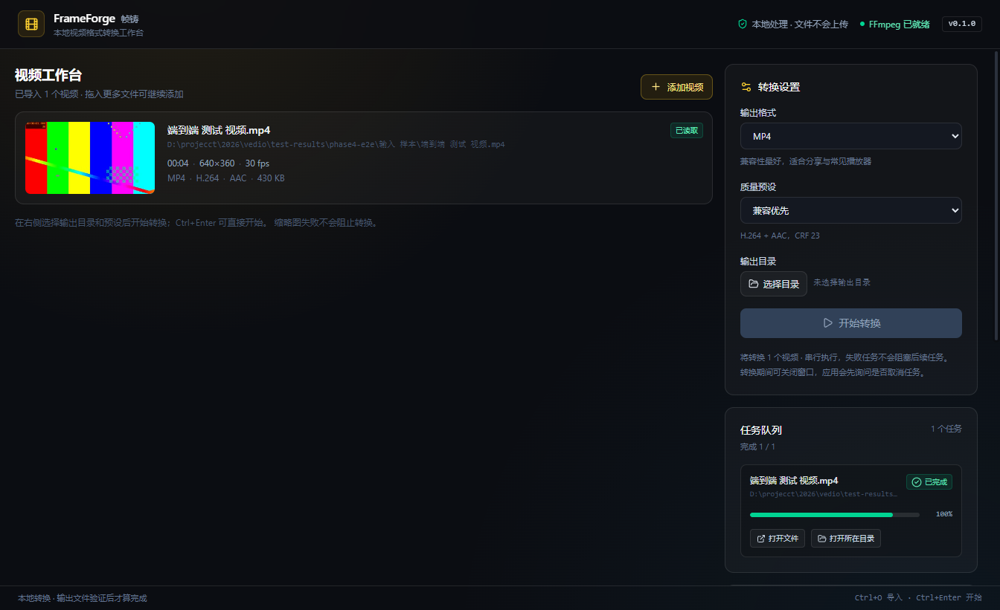

# FrameForge（帧铸）

本地视频格式转换桌面客户端。目标是用 Electron + React + TypeScript 调用真实的 `ffmpeg` / `ffprobe`，完成视频导入、媒体信息读取、缩略图、格式转换和任务队列。

> 当前进度：**阶段 4（功能型产品体验收尾）已完成**。视觉设计方向等待开发者确认后再进入可选的整体视觉重做。
> 下一阶段执行计划见 [docs/DELIVERY_PLAN.md](docs/DELIVERY_PLAN.md)：先打通 FFmpeg 随包、安装包和干净机器验证，再做 WebM/MP3、高级设置与动态剩余时间。
> 已接入系统文件选择器、受控拖拽导入、真实 FFprobe/FFmpeg、中文/空格路径、无音轨和坏文件处理；MP4/MKV 转换会实际启动 FFmpeg，进度来自 `-progress pipe:1`，成功状态必须经过退出码和输出文件双重验证。
> 界面不会用定时器伪造进度，也不会在失败时假装生成输出文件；完成任务可打开文件或所在目录，失败任务可复制错误并打开日志目录。



> 想从代码层面理解这个项目，先读 [docs/DEVELOPER_GUIDE.md](docs/DEVELOPER_GUIDE.md)：它按“导入 → 探测 → 缩略图 → 转换 → 队列 → UI”讲清真实调用链、关键文件、安全边界和测试方式。

## 技术栈

- Electron 45 + electron-vite 6
- React 19 + TypeScript 5.9
- Vite 8 + Tailwind CSS 4
- Vitest 5 + Testing Library
- electron-builder（Windows 打包）

## 环境要求

- Windows 10/11 x64
- Node.js >= 22.12
- npm >= 10
- FFmpeg / FFprobe 可用：
  - 推荐安装 FFmpeg 并加入系统 `PATH`；或
  - 把 `ffmpeg.exe` 与 `ffprobe.exe` 放入项目的 `resources/ffmpeg/`；或
  - 用 `FRAMEFORGE_FFMPEG_DIR` 指向同时包含两者的目录。

详细的路径顺序、打包分发和许可证注意事项见 [docs/FFMPEG.md](docs/FFMPEG.md)。

## 安装

```bash
npm install
```

本机网络无法直连 GitHub 时，项目根目录的 `.npmrc` 已配置 Electron 二进制镜像。若在其他机器安装失败，可显式设置：

```powershell
$env:ELECTRON_MIRROR="https://npmmirror.com/mirrors/electron/"
npm install
```

## 常用命令

```bash
npm run dev        # 启动开发模式，打开真实 Electron 窗口
npm test           # 运行 Vitest 测试（真实 FFmpeg 集成用例会实际启动 ffmpeg/ffprobe）
npm run typecheck  # TypeScript 类型检查
npm run build      # 构建 main / preload / renderer 到 out/
npm run dist:dir   # 构建并生成免安装目录版
npm run dist:win   # 构建 Windows 安装包（完整 FFmpeg 随包在阶段 5 收尾）
```

## 目录结构

```text
electron/
  main/
    index.ts                    # main() 编排：日志 → IPC → 窗口 → 生命周期
    orchestrator.ts             # 可测试的启动顺序
    window-options.ts           # 窗口安全配置
    security.ts                 # 禁止外部导航与新窗口
    ipc/
      handlers.ts               # 受控 IPC：应用信息 / 导入 / 转换 / 打开 / 复制 / 日志
      guard.ts                  # IPC 调用方校验
    services/
      close-guard.ts             # 关闭窗口前的任务确认、取消和等待
      logger.ts                 # electron-log 配置
      logger-core.ts            # 可测试的命名 logger
      app-info.ts               # 运行环境信息
      ffmpeg/
        process.ts              # spawn(executable, args, { shell: false }) 封装
        resolver.ts             # 环境变量 / 随包目录 / 系统 PATH 解析
        status.ts               # 真实执行 -version 并缓存状态
      media/
        probe.ts                # 路径校验、ffprobe JSON 解析、真实探测
        thumbnail.ts            # 真实 ffmpeg 单帧抽取为 320×180 JPEG
        media-service.ts        # 逐文件编排与缩略图降级
        import-validation.ts    # 拖拽导入路径、扩展名和数量校验
      conversion/
        args.ts                 # MP4/MKV 参数、质量预设、-progress pipe:1
        output.ts               # _converted 命名、冲突避让、目录校验、临时文件
        output-actions.ts       # 校验已完成任务并打开文件/所在目录
        progress.ts             # 进度行解析和 0–99% 上限
        runner.ts               # 真实转换、输出验证、临时文件清理
        queue.ts                # 串行队列、状态机、失败隔离、取消
        validation.ts           # IPC 输入、任务 ID、剪贴板文本验证
      system/
        open-path.ts            # 只打开主进程确认存在的目录
        path-exists.ts          # 受控路径存在性检查
  preload/
    index.ts                    # contextBridge 最小暴露面
    api.ts                      # 可测试的 DesktopAPI 工厂
shared/
  ipc.ts                        # 主进程 / preload / renderer 共享 IPC 契约
  conversion.ts                 # 格式、预设、任务状态、进度事件类型
  media.ts                      # 媒体、缩略图、FFmpeg 状态类型
  media-format.ts               # 时长 / 帧率 / 大小 / 分辨率格式化
src/
  App.tsx                       # 导入、输出设置、队列订阅和任务状态
  components/                   # AppShell / EmptyState / EnvironmentPanel / MediaCard / MediaList / ConversionSettings / JobQueue
  types/ui.ts                   # 渲染层可加载状态
  styles/index.css              # Tailwind + 全局样式
test/
  phase-01-skeleton.test.tsx    # 阶段 1：骨架、安全、IPC、日志
  phase-02-media.test.tsx       # 阶段 2：解析、路径、FFmpeg、导入 UI
  phase-03-conversion.test.tsx  # 阶段 3：参数、进度、队列、真实转换、取消、UI
  phase-04-polish.test.tsx      # 阶段 4：拖拽、输出操作、关闭保护、快捷键、UI
  helpers/test-logger.ts        # 测试作用域 logger
  setup.ts                      # 全局 START / PASS / FAIL 日志
docs/
  PROJECT_SPEC.md               # 需求规格
  DEVELOPER_GUIDE.md            # 开发者实现教程：真实调用链、架构与读代码路线
  DELIVERY_PLAN.md              # P0/P1 交付范围、里程碑顺序与验收标准
  AI_CODING_PROMPT.md           # 分阶段执行提示词
  AI_DEVELOPMENT_LOG.md         # 真实命令、结果、决策与问题
  FFMPEG.md                     # FFmpeg 路径与分发方案
  LOGGING.md                    # 日志与测试日志约定
```

## 阶段 3–4 已完成的能力

1. **系统文件选择器与真实媒体信息**
   - 一次选择多个视频；文件选择、路径校验、ffprobe 和缩略图都在主进程完成。
   - 读取时长、分辨率、帧率、容器、视频/音频编码和文件大小。
   - 中文/空格路径、无音轨和损坏文件都有真实集成测试。

2. **输出设置**
   - MP4 / MKV 两种输出容器。
   - 兼容优先（CRF 23）、质量优先（CRF 20）、体积优先（CRF 28）三个 H.264 预设。
   - 通过系统目录选择器选择输出目录；开始前显示完整保存位置。
   - 队列运行期间禁用再次启动，避免同一批任务被重复提交。

3. **真实转换与串行队列**
   - 通过 `spawn(ffmpegPath, args, { shell: false })` 执行真实 FFmpeg。
   - MP4 使用 H.264 + AAC + `-movflags +faststart`；MKV 不传 MP4 专属参数。
   - 默认输出名为 `原名称_converted.扩展名`；冲突时生成 `(1)`、`(2)`，不覆盖已有文件。
   - 先写同目录临时文件，退出码成功、临时文件非空、最终文件非空后才标记完成。
   - 进度来自 `-progress pipe:1 -nostats`，解析 `out_time_us` / `out_time_ms` / `out_time`；成功前最多 99%。
   - 单任务串行执行；一个任务失败不会清空后续队列。
   - 取消会终止真实子进程，并清理临时输出。
   - 失败任务保留可读错误和可展开的 stderr 摘要。

4. **错误与边界**
   - 无音轨输入使用 `-an`，不会凭空生成音轨。
   - 损坏视频只让当前任务失败，后续任务继续。
   - FFmpeg 缺失时禁用导入和转换，并显示修复说明。
   - 输出目录不存在、不是目录或不可写时拒绝启动。
   - 输出目录与源文件相同、格式相同也不会覆盖源文件。

5. **阶段 4 工作台体验**
   - 支持把视频文件直接拖入工作区导入；拖拽路径由 preload 的 `webUtils.getPathForFile` 获取，不使用不可靠的 `File.path`。
   - `Ctrl+O` 打开受控文件选择器，`Ctrl+Enter` 在条件满足时开始转换。
   - 已完成任务显示“打开文件”和“打开所在目录”；按钮只传任务 ID，由主进程从队列取出真实输出路径并再次检查文件存在性。
   - 失败任务显示“复制错误”和“打开日志目录”；复制内容包含文件名、错误和 FFmpeg 日志摘要。
   - 有排队或运行任务时关闭窗口会弹出确认；确认后取消全部任务、等待真实子进程退出和临时文件清理，再关闭窗口。
   - 任务队列显示完成/失败/进行中汇总；移除面向开发者的“阶段 3”文案。
   - 已检查窄窗口布局和长路径截断；窄窗口下右侧面板自动堆叠，无横向溢出。

## 安全边界

- `contextIsolation: true`
- `nodeIntegration: false`
- `sandbox: true`
- `webSecurity: true`
- preload 只暴露十三个受控方法：
  - `getAppInfo()`
  - `getFfmpegStatus()`
  - `selectVideos()`
  - `importVideos(paths)`
  - `getPathForFile(file)`
  - `selectOutputDirectory()`
  - `startConversions(request)`
  - `cancelConversion(jobId)`
  - `onConversionUpdate(callback)`，返回取消订阅函数
  - `openOutputFile(jobId)`
  - `showOutputInFolder(jobId)`
  - `copyText(text)`
  - `openLogDirectory()`
- 不暴露 `ipcRenderer`、`fs`、`child_process`、`dialog` 或通用命令执行接口。
- renderer 不能传入自定义 FFmpeg 参数；转换参数由主进程按格式和预设构造。
- 打开文件/目录和复制文本都通过主进程受控 IPC：输出路径只接受任务 ID，日志目录由主进程确定，复制文本限制为 20,000 字符。
- 拖拽导入只接受有限数量、绝对路径和已知视频扩展名；真正的媒体合法性仍由 FFprobe 验证。
- 主进程校验 IPC 调用方必须是当前主窗口。
- 拒绝新窗口与外部导航。
- renderer 代码不得导入 Node.js / Electron 模块，测试会扫描 `src/**` 强制检查。
- 所有外部进程都通过：

```ts
spawn(executablePath, args, { shell: false });
```

## 日志

主进程使用 `electron-log`，同时输出控制台与文件。启动日志中会打印真实 `logFile` 路径；Windows 下通常位于：

```text
%APPDATA%\frameforge\logs\main.log
```

日志级别：`debug` / `info` / `warn` / `error`。每个服务函数记录开始、成功（含耗时）和失败（含错误详情）。FFmpeg/FFprobe 的完整参数记录在 `debug`，失败时记录退出码和 stderr 摘要。

## 测试日志

每个阶段一个测试文件，文件内部按流程分组。每个测试文件都有中文头注释，说明测试目标、对应需求和断言原因。每个用例自动输出：

```text
START 用例名称
STEP  关键步骤
PASS  用例名称 { durationMs: 12 }
```

失败时输出 `FAIL` 和错误对象。测试日志使用真实的 `electron-log/node`，只写控制台，不写入用户运行日志。

真实 FFmpeg 用例会实际启动本机 `ffmpeg` / `ffprobe` 生成并读取样本。若本机没有 FFmpeg，相应用例会明确标记为 skip 并记录原因，不会伪装成通过。

## 当前测试

2026-10-21 已执行：

```text
npm test           4 个测试文件，87 个测试全部通过，无 skip
                   - 阶段 1：24 个
                   - 阶段 2：26 个
                   - 阶段 3：23 个（含真实转换、进度、取消和失败集成）
                   - 阶段 4：14 个（拖拽、输出操作、关闭保护、快捷键、UI）
npm run typecheck  通过
npm run build      main / preload / renderer 构建通过
npm run dist:dir   免安装目录版构建成功；打包版启动并显示 FFmpeg 已就绪
```

打包版截图：`docs/evidence/phase4-packaged.png`；窄窗口截图：`docs/evidence/phase4-narrow.png`。

真实集成覆盖：

- 打包版通过 CDP 向真实 renderer 派发带文件路径的拖拽事件，工作区收到文件并显示真实缩略图和媒体信息；
- 中文/空格路径的 4 秒 640×360 带音轨 MP4 → MP4：输出 423,499 字节，H.264，队列 DOM 显示“已完成 / 100%”和“打开文件 / 打开所在目录”；
- 剪贴板 API 真实写入后由 PowerShell `Get-Clipboard` 读回 `FrameForge 阶段 4 剪贴板验证`；
- 打开未完成任务被主进程拒绝，错误包含“任务尚未成功完成”；
- 窄窗口下无横向溢出（`scrollWidth <= innerWidth`），右侧面板自动堆叠；
- 既有阶段 3 真实集成仍全部执行：无音轨、输出名冲突、损坏文件、取消和输出验证。

阶段 4 真实结果文件：

- `test-results/phase4-red.log`：模块不存在的真实 RED；
- `test-results/phase4-green-3.log`：阶段 4 单文件 14/14；
- `test-results/phase4-final3.log`：收尾全量 87/87；
- `test-results/phase4-final3-typecheck.log`：收尾类型检查通过；
- `test-results/phase4-final-dist.log`：构建与目录版打包日志；
- `test-results/phase4-final-e2e.log`：打包版拖拽、真实转换、剪贴板、错误拒绝和窄窗口记录。

## 已知限制

- 当前是单窗口、单队列、串行转换；不支持并发编码或队列暂停/重排。
- 功能型体验已收尾，整体视觉重做尚未开始；等待开发者选定设计参考和组件策略。
- 输出目录和格式/预设尚未持久化，关闭应用后需要重新选择。
- 关闭保护已有单元测试和主进程接线；原生确认对话框的真实点击流程尚未自动化。
- “打开文件”和“打开日志目录”的真实系统窗口未在自动化中反复打开；输出目录/文件存在性和 IPC 拒绝路径已测试。
- 拖拽端到端验证使用单文件；多文件由同一路径数组、数量校验和单元测试覆盖，未单独做真实多文件拖拽。
- FFmpeg 随包二进制尚未放入安装包；当前打包版会回退系统 PATH。最终分发与许可证核对在阶段 5 完成。
- 原生文件选择器仍需人工点击，未做系统对话框自动化。
- 未保留字幕轨，未做硬件加速；这些是当前 MVP 的明确范围取舍。
- AOCI 完整索引仍为 0 条 Entry；阶段 4 未在空索引上强行生成语义。
- `.npmrc` 中的镜像配置面向当前网络环境，可按需删除。
