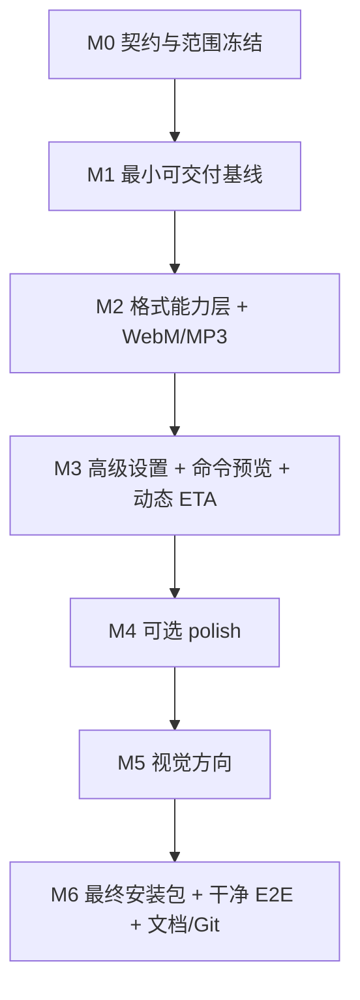

# FrameForge 交付与增强计划（P0 / P1）

> 记录时间：2026-10-21
>
> 当前状态：阶段 4 已完成；**M0 / M1 / M2 已完成**。Windows 安装包已内置 FFmpeg 并通过无 PATH 真实转换；WebM（VP9 + Opus）与仅音频 MP3 已通过真实 FFmpeg、FFprobe 和打包版 E2E 验证；M3 尚未开始。
>
> 文档关系：`docs/PROJECT_SPEC.md` 是需求底线；本文件定义阶段 4 之后的执行优先级、顺序和验收标准，不替代原始规格。

---

## 0. 一句话策略

**先把“可交付的 Windows 客户端”打通，再增加格式和高级能力；每个里程碑都要有真实证据，不把计划写成已完成。**

这样即使后续增强没做完，也始终有一个可以安装、可以运行、可以演示的版本。

---

## 1. 目标

### 1.1 产品目标

- 做一个真正能给普通用户使用的 Windows 桌面视频转换客户端；
- 不依赖用户预装 Node.js、Electron、Chrome/Chromium；
- 不依赖用户预装 FFmpeg；
- 支持 MP4、MKV，并扩展到 WebM 和仅音频 MP3；
- 提供高级设置和只读命令预览，让懂技术的用户能调试，但普通用户不被吓到；
- 进度、剩余时间、错误和输出都基于真实 FFmpeg 结果；
- 最终形成可展示的 GitHub 项目，而不只是一次性作业。

### 1.2 工程目标

- 安装包/便携包可以在干净 Windows 环境运行；
- FFmpeg 随包分发，许可证和来源写清楚；
- 主进程 / preload / renderer 的安全边界不退化；
- 新功能有测试、有真实转换、有失败路径；
- 文档能区分“已实现”“已测试”“未验证”。

### 1.3 Mac 边界

- **预留架构，不承诺交付。**
- 路径、可执行文件后缀、资源目录和打包配置要考虑跨平台；
- 不在 Windows 上假装产出可靠的 macOS `.dmg`；
- 没有 macOS 构建、签名、notarization 和真实测试前，README 只能写“架构预留，未验证”。

---

## 2. 已确认范围

### 2.1 P0：必须完成

| 编号 | 事项 | 验收标准 |
|---|---|---|
| P0-1 | FFmpeg 随包 | 安装包内含 `ffmpeg`/`ffprobe`；移除系统 PATH 后仍能探测、缩略图、转换；状态来源显示 `bundled` |
| P0-2 | Windows 安装包/便携包 | `npm run dist:win` 产出可安装的 NSIS 安装包；另提供完整目录 zip；图标、产品名、版本正确 |
| P0-3 | 干净机器真实 E2E | 无 Node、无 FFmpeg PATH 的 Windows 环境安装 → 导入中文/空格路径视频 → 转换 → 取消 → 打开输出 → 卸载 |
| P0-4 | 移除主界面环境面板 | 工作台不再展示 Electron/Node/FFmpeg 版本和路径；FFmpeg 缺失时显示明确错误和解决方法 |
| P0-5 | 文档与 GitHub 发布 | `TEST_PLAN.md`、`SESSION_SUMMARY.md`、README、截图、证据日志、许可证说明；Git 提交和 release 资产 |

**P0 的完成定义：** 不是一个“能启动的 exe”，而是别人拿到安装包后，在干净机器上能完成真实转换。

### 2.2 P1：高性价比增强

| 编号 | 事项 | 验收标准 |
|---|---|---|
| P1-0 | 格式能力层（前置工程） | 建立 `OutputProfile`/能力探测；UI 只显示当前 FFmpeg 真正支持的编码器；后续格式不再靠 `if/else` 堆叠 |
| P1-1 | WebM（VP9 + Opus） | 真实输出 `.webm`；有音轨/无音轨都能处理；编码器缺失时禁用并说明原因 |
| P1-2 | 仅音频 MP3 | 从有音轨视频提取 MP3；无音轨输入给出明确错误；元数据、进度、输出校验正常 |
| P1-3 | 高级设置 + 只读命令预览 | 分辨率、音频码率、CRF 可调；参数校验；预览命令与实际执行参数一致；不开放任意命令输入 |
| P1-4 | 动态剩余时间 | 从 FFmpeg `speed` 和 `out_time` 计算；前几秒显示“估算中”；不伪造倒计时 |
| P1-5 | 完成提示音（可选） | 批次成功后播放一次轻提示音；可静音；失败/取消不播放 |
| P1-6 | 输出设置持久化（可选） | 输出目录、格式、质量预设重启后恢复；不持久化敏感信息 |

> P1-0 不是用户直接看到的功能，但它是 P1-1/P1-2/P1-3 的前置条件。没有能力层，格式越多，参数分支和假支持越多。

### 2.3 明确不做 / 延后

以下内容不在当前 P0/P1 范围内：

- macOS `.dmg` 的正式交付和签名；
- 应用打开/关闭动画；
- 应用内播放转换后的视频/音频；
- GIF、MOV、H.265、AV1；
- “试转 5 秒”预览；
- 硬件编码全矩阵（NVENC/QSV/AMF/VideoToolbox）；
- 用户可编辑的任意 FFmpeg 命令；
- 队列暂停/继续/重排；
- 字幕轨保留、视频剪辑时间线、滤镜链编辑器。

这些不是永远不做，而是**不能让它们挤占 P0 的交付时间**。

---

## 3. 推荐执行顺序



### 为什么是这个顺序

1. **先选 FFmpeg 构建，再做格式。** 随包 FFmpeg 里到底有没有 `libvpx-vp9`、`libopus`、`libmp3lame`，决定了 WebM/MP3 能不能真的做。先做 UI 再发现编码器缺失，就是假支持。
2. **先做能力层，再做高级设置。** 格式、编码器、音频模式和参数校验需要同一个模型；否则高级面板会变成一堆特判。
3. **先做格式，再做 ETA。** ETA 依赖源时长和进度，格式扩展会改探测/参数/测试；先稳定转换链路，再做时间显示。
4. **视觉放在功能冻结之后。** 格式矩阵、高级面板、音频模式都会改变布局；先做视觉会返工。
5. **安装包提前打样，最后再正式验收。** M1 先证明“FFmpeg 随包 + 安装包 + 干净机器”这条路能走通；M6 在功能冻结后做最终安装包和完整 E2E。
6. **文档和 Git 不是最后才想。** 每个里程碑结束都记录真实证据；M6 做最终整理、提交和 release。

---

## 4. 各里程碑

### M0：契约与范围冻结（已完成）

**目标：** 在写业务代码前，把数据模型、资源布局和验收标准定下来。

**任务：**

- 确认 P0/P1/P2 范围，不再临时加格式；
- 设计 `OutputProfile` 和 `ConversionSettings` 的目标结构；
- 设计 FFmpeg 能力探测的返回类型；
- 确定 FFmpeg 资源目录布局（按平台/架构）；
- 确定安装包策略：NSIS 安装包 + 完整目录 zip；
- 确定静态构建优先，shared 构建作为备选；
- 确定 Mac 预留约束：不使用 Windows 专用路径、不硬编码 `.exe`、资源按平台分层；
- 更新 `DELIVERY_PLAN.md` 和开发日志。

**验收：**

- 文档评审通过；
- 每个 P0/P1 项都有可执行验收标准；
- 没有“先写 UI 再说”的悬空项；
- 不改业务代码。

**产出：**

- 本文件；
- `AI_DEVELOPMENT_LOG.md` 的范围确认记录；
- README/开发者教程的链接更新。

---

### M1：最小可交付基线（P0 核心，已完成）

**目标：** 在增强功能之前，先证明“这个应用可以交给别人用”。

**任务：**

1. **P0-1 FFmpeg 随包**
   - 选择 Windows 静态构建（优先）或完整 shared 构建；
   - 放入构建资源目录，`extraResources` 复制到 `resources/ffmpeg`；
   - 更新 `resolver.ts`，打包模式优先读取随包目录；
   - 确保 `ffmpeg` 和 `ffprobe` 必须成对存在；
   - 添加许可证/来源说明和校验脚本；
   - 不在 Git 提交二进制。

2. **P0-2 安装包打样**
   - `electron-builder` 增加 NSIS 和 zip 目标；
   - 配置产品名、appId、版本、图标；
   - 生成安装包和完整目录 zip；
   - 安装后能启动，资源路径正确。

3. **P0-4 主界面清理**
   - 从工作台移除 `EnvironmentPanel`；
   - 顶栏不再展示 FFmpeg 版本/路径；
   - FFmpeg 缺失时显示阻塞式错误和“查看解决方法/打开日志目录”；
   - 保留设置/关于/诊断入口。

4. **测试**
   - 单元测试：resolver 优先随包、成对校验、缺失回退；
   - 打包 smoke test：随包 FFmpeg 能 `-version`、能导入、能转换一个 MP4；
   - 现有 87 个测试不能退化。

**验收：**

- 把系统 PATH 中的 FFmpeg 临时移走，打包版仍能导入和转换；
- 日志中 `source` 为 `bundled`；
- 安装包能在干净目录启动；
- 主界面不再出现开发者环境面板；
- 有一个可回滚的 Git 提交（需开发者确认）。

**注意：** 这一步不追求最终视觉，也不做 WebM/MP3；先把交付链打通。

**M1 实际结果（2026-10-21）：**

- 随包 `ffmpeg 8.0.1-full_build-www.gyan.dev`（Windows x64 shared build），连同全部 DLL、LICENSE、README 和 manifest 一并复制；
- `resources/ffmpeg/<platform>-<arch>/` 优先，旧平铺目录兼容，系统 PATH 最后；
- `npm run dist:win` 产出 NSIS 安装包和完整目录 zip，使用自定义图标；
- 静默安装到新目录后，移除 `PATH`、`FRAMEFORGE_FFMPEG_DIR`，真实拖拽导入中文/空格路径视频并完成 MP4 转换；\n- 完整目录 zip 解压后通过同一套无 PATH E2E；静默卸载退出码 0，安装目录被清理；
- 状态返回 `source: "bundled"`，输出经随包 `ffprobe` 验证为 H.264 640×360；
- 主界面环境面板已移除，保留 FFmpeg 缺失错误、重新检测和日志入口；
- 测试从 87 增至 93，全部通过；证据见 `docs/TEST_PLAN.md`、`test-results/phase5-*`。

---

### M2：格式能力层 + WebM/MP3（P1-0/P1-1/P1-2）

**目标：** 把“只有 MP4/MKV”扩展成用户能感知的格式矩阵，同时不产生假支持。

**任务：**

1. **P1-0 能力层**
   - 用 `ffmpeg -encoders` 探测 `libx264`、`libvpx-vp9`、`libopus`、`libmp3lame`、AAC 等；
   - 主进程缓存能力，IPC 返回给 UI；
   - `OutputProfile` 描述容器、视频编码、音频编码、扩展名、默认参数；
   - 参数构造只依赖 profile，不在 UI 里拼 FFmpeg 参数。

2. **P1-1 WebM**
   - VP9 + Opus；
   - 视频：`libvpx-vp9`，合理 CRF/码率；
   - 音频：`libopus`；
   - 无音轨输入用 `-an`；
   - 真实输出和播放验证。

3. **P1-2 MP3**
   - 仅音频 profile；
   - 有音轨才允许选择；
   - 无音轨给出明确错误；
   - 输出 `.mp3`，验证文件非空、可播放。

4. **UI**
   - 格式选择显示容器、编码、兼容性说明；
   - 编码器不可用时禁用并解释原因；
   - 音频-only 时隐藏视频相关设置。

**验收：**

- 真实视频 → WebM 成功，`ffprobe` 确认 VP9/Opus；
- 真实视频 → MP3 成功，`ffprobe` 确认 MP3 音频；
- 无音轨视频 → MP3 被正确拒绝；
- 编码器缺失时 UI 不显示“假可用”；
- 队列、进度、取消、冲突命名对新增格式仍有效；
- 打包版至少抽测 WebM/MP3 各一次。

**M2 实际结果（2026-10-22）：**

- `shared/capabilities.ts` + `FfmpegCapabilityService` 真实执行 `ffmpeg -hide_banner -encoders`，缓存能力矩阵；缺失编码器时格式禁用并显示原因；
- `OutputProfile` 驱动 MP4/MKV/WebM/MP3 参数；WebM 使用 `libvpx-vp9` + `libopus`（CRF + `-b:v 0`），MP3 使用 `-vn` + `libmp3lame`；
- MP3 入队前用真实 FFprobe 探测音轨，无音轨直接失败且不启动 FFmpeg；
- 转换完成后调用 FFprobe 校验容器/编码/轨道与 profile 一致，不一致会删除输出并标记失败；
- 测试 6 个文件 112 个全部通过；真实 WebM 输出 `VP9 + Opus`，真实 MP3 输出无视频轨；
- 打包版无 PATH E2E 依次完成 MP4（49,555 字节，H.264/AAC）、WebM（73,708 字节，VP9/Opus）、MP3（67,019 字节，仅 MP3 音频），截图 `docs/evidence/phase6-formats.png`、`docs/evidence/phase6-mp3.png`。

---

### M3：高级设置 + 命令预览 + 动态 ETA（P1-3/P1-4）

**目标：** 提升“可调试性”和“专业感”，但不破坏普通用户的主流程。

**任务：**

1. **P1-3 高级设置**
   - 分辨率：原始 / 1080p / 720p / 480p；默认不放大；保证偶数尺寸；
   - 音频码率：128 / 192 / 256 kbps（按音频编码可用性）；
   - CRF：在预设基础上允许 18–30 的自定义；
   - 音频模式：保留 / 移除；
   - 高级面板默认折叠；
   - 只读命令预览，和实际 `buildConversionArgs()` 使用同一个结果；
   - 复制命令；
   - 所有输入在主进程校验，renderer 不能传任意参数。

2. **P1-4 动态 ETA**
   - 解析 `-progress` 的 `speed=1.23x`；
   - 统一 `out_time_us` / `out_time_ms` 的微秒语义；
   - 用最近几个采样平滑速度；
   - `剩余时间 = (总时长 - 已输出时长) / 速度`；
   - 前几秒显示“估算中”，不显示假倒计时；
   - UI 显示“已用 / 剩余 / 速度”。

**验收：**

- 修改分辨率/CRF/音频码率会真实改变命令和输出；
- 非法值被主进程拒绝；
- 命令预览与实际执行参数一致；
- ETA 来自真实 speed，暂停/取消后不再显示过期时间；
- 真实转换中能观察到 ETA 更新；
- 原有格式和队列测试不退化。

---

### M4：可选 polish（P1-5/P1-6）

**只有 M1–M3 全绿再做。**

- P1-5 完成提示音：
  - 批次全部成功后播放一次；
  - 失败/取消不播放；
  - 可静音；
  - 使用自生成音效或 CC0 素材，避免版权问题。
- P1-6 输出设置持久化：
  - 保存输出目录、格式、质量预设；
  - 优先主进程写用户数据目录 JSON，不引入数据库；
  - 不保存敏感信息；
  - 重启后恢复，损坏配置有回退。

**如果时间不够，先砍这两项，不影响 P0/P1 核心。**

---

### M5：视觉方向

**前提：** 功能 UI 已冻结，格式矩阵和高级面板结构不再大改。

**任务：**

- 根据开发者选定的设计参考/组件库做整体视觉；
- 保持现有交互和真实功能不变；
- 检查窄窗口、长路径、错误态、空状态、加载态；
- 更新打包版截图和窄窗口截图；
- 不为了视觉引入假按钮、假统计、假进度。

**验收：**

- 视觉改动后所有测试通过；
- 关键流程仍可操作；
- 截图与真实打包版一致；
- 没有横向溢出。

---

### M6：最终交付

**目标：** 把“能跑”变成“别人拿到也能跑，且证据完整”。

**任务：**

1. **最终安装包/便携包**
   - 重新执行 `npm run dist:win`；
   - 安装包 + 完整目录 zip；
   - 校验图标、版本、产品名、FFmpeg 资源；
   - 记录 SHA256。

2. **干净机器完整 E2E（P0-3）**
   - 无 Node、无 FFmpeg PATH、无开发工具；
   - 安装；
   - 导入中文/空格路径视频；
   - 转换 MP4、WebM、MP3；
   - 取消一个任务；
   - 打开输出文件/所在目录；
   - 检查日志目录；
   - 卸载/删除；
   - 记录真实截图和日志。

3. **文档（P0-5）**
   - `docs/TEST_PLAN.md`：手工验收、自动化、未覆盖项；
   - `docs/SESSION_SUMMARY.md`：目标、架构、决策、反馈、完成/未完成、测试证据；
   - `README.md`：安装、使用、截图、命令、限制、FFmpeg 许可证；
   - `docs/AI_DEVELOPMENT_LOG.md`：补齐每个里程碑的真实结果；
   - `docs/FFMPEG.md`：最终二进制来源、版本、许可证；
   - `THIRD_PARTY_NOTICES.md`：FFmpeg 和其他依赖。

4. **Git / GitHub**
   - 清理 `node_modules`、`release`、临时视频、日志、密钥；
   - 确认 `.gitignore` 不提交 FFmpeg 二进制和大文件；
   - 按里程碑提交，最终打 tag；
   - 上传安装包/zip 作为 release 资产；
   - README 写清“源码运行”和“直接下载安装包”两条路径。

5. **最终审计**
   - 对照 `PROJECT_SPEC.md` 验收单；
   - 对照本文件 P0/P1；
   - 明确列出未验证项；
   - 不再新增功能。

---

## 5. 关键设计决定

### 5.1 格式模型

不要继续把格式写死为：

```ts
type OutputFormat = 'mp4' | 'mkv';
```

改成能表达“容器 + 视频编码 + 音频编码”的 profile：

```ts
interface OutputProfile {
  id: string;
  container: 'mp4' | 'mkv' | 'webm' | 'mp3';
  videoCodec: 'h264' | 'vp9' | null;
  audioCodec: 'aac' | 'opus' | 'mp3' | null;
  extension: string;
  supportsFaststart: boolean;
  // ...
}
```

这样 WebM、MP3、未来的 MOV/H.265 不会把 `args.ts` 和 UI 变成条件分支泥潭。

### 5.2 能力探测

- 主进程执行 `ffmpeg -hide_banner -encoders`；
- 缓存结果；
- 只向 UI 暴露布尔能力和原因；
- UI 只显示当前构建真正支持的 profile；
- 测试覆盖“编码器缺失”的禁用路径。

### 5.3 单一参数来源

- `buildConversionArgs()` 是唯一参数构造入口；
- 实际执行和“命令预览”使用同一个结果；
- renderer 只传结构化设置，不传原始参数数组；
- 高级设置的所有值在主进程校验。

### 5.4 ETA

- 只用真实 `speed`/`out_time`；
- 没有稳定速度就显示“估算中”；
- 不使用“文件大小 × 常数”伪造精确时间；
- GPU 信息只在真正使用硬件编码时才有意义。

### 5.5 FFmpeg 资源布局

目标布局示例：

```text
resources/
  ffmpeg/
    win32-x64/
      ffmpeg.exe
      ffprobe.exe
    darwin-arm64/        # 预留，暂不交付
      ffmpeg
      ffprobe
```

Resolver 先查 `<platform>-<arch>`，再回退 flat 目录；具体实现以测试为准。

### 5.6 安装包策略

- 主交付：NSIS 安装包；
- 次交付：完整目录 zip（解压即用）；
- 单文件 portable exe 暂不作为主目标，避免解压路径、杀毒误报和 FFmpeg 资源定位复杂度；
- 所有 release 资产提供 SHA256。

### 5.7 配置持久化（如果做）

- 使用主进程写用户数据目录 JSON；
- 不引入数据库；
- 不让 renderer 直接写文件；
- 配置损坏时回退默认值。

---

## 6. 风险与应对

| 风险 | 影响 | 应对 |
|---|---|---|
| FFmpeg 构建缺少 VP9/Opus/MP3 编码器 | WebM/MP3 变成假支持 | 先做能力探测；选择包含所需编码器的构建；缺失时禁用 |
| 随包 FFmpeg 是 shared build，漏 DLL | 干净机器启动失败 | 优先静态构建；shared 必须整目录复制并做无 PATH 验证 |
| FFmpeg GPL 再分发义务 | 不能合法发布 | 保留许可证、来源、构建参数；提供源码获取方式；不确定时先不发布安装包 |
| 安装包在干净机器失败 | P0 直接不达标 | M1 提前打样；M6 最终 VM 验收；不用开发机 PATH 代替 |
| 格式/参数组合测试爆炸 | 时间不够、回归 | 每个格式只保留一套默认参数 + 少量高级选项；不做全矩阵 |
| ETA 不准 | 用户不信任 | 只用真实 speed；前几秒显示估算中；不伪造 |
| 视觉返工 | 浪费时间 | 功能冻结后再做视觉 |
| Mac 承诺过度 | 交付失信 | 只写“架构预留，未验证”；不在 Windows 上宣称 Mac 可用 |
| 安装包/二进制进 Git | 仓库臃肿、许可证风险 | `.gitignore`、release 资产、下载/校验脚本 |

---

## 7. 状态板

| 项目 | 状态 | 证据 |
|---|---|---|
| 阶段 4 功能 UX | 已完成 | `docs/AI_DEVELOPMENT_LOG.md`、87/87 测试、打包 E2E |
| P0/P1 范围确认 | 已完成（文档） | 本文件 |
| P0-1 FFmpeg 随包 | 已完成 | `resources/ffmpeg/win32-x64/`、`docs/FFMPEG.md`、无 PATH E2E `source: bundled` |
| P0-2 安装包/便携包 | 已完成（M1 基线） | `release/FrameForge Setup 0.1.0.exe`、`release/FrameForge-0.1.0-win.zip`、自定义图标、zip 解压 E2E |
| P0-3 干净机器 E2E | 部分完成 | 新目录安装 + 移除 PATH + 真实转换 + zip + 静默卸载通过；独立干净 VM 待 M6 |
| P0-4 移除环境面板 | 已完成 | 主界面无环境面板；FFmpeg 错误态、重新检测、日志入口已测试 |
| P0-5 文档/GitHub | 进行中 | `README.md`、`docs/TEST_PLAN.md`、`THIRD_PARTY_NOTICES.md` 已建立；Release 待 M6 |
| P1-0 格式能力层 | 已完成 | `shared/capabilities.ts`、`FfmpegCapabilityService`、真实 `ffmpeg -encoders` |
| P1-1 WebM | 已完成 | 真实 VP9 + Opus、无音轨 `-an`、打包版 E2E 73,708 字节 |
| P1-2 MP3 | 已完成 | 真实 MP3 无视频轨、无音轨入队拒绝、打包版 E2E 67,019 字节 |
| P1-3 高级设置/命令预览 | 未开始 | — |
| P1-4 动态 ETA | 未开始 | — |
| P1-5 完成提示音 | 未开始（可选） | — |
| P1-6 设置持久化 | 未开始（可选） | — |
| 视觉方向 | 未开始 | — |
| Git 基线提交 | 已完成 | `87d5395` + `1f74c6d`，已推送到 `origin/main`；M1 基线 `0681c38`；M2 本地提交待推送 |

> 2026-10-21 已建立首个基线提交并推送；M1 完成后按里程碑提交，最终 release 前再做清理和 tag。

---

## 8. 下一步

1. M1/M2 已完成，进入 **M3：高级设置 + 只读命令预览 + 动态 ETA**；
2. M3 先冻结设置模型和参数预览契约，再改 UI，避免高级面板变成格式特判；
3. 每个里程碑结束更新开发日志、测试计划、README 和状态板；
4. M6 再做最终安装包、独立干净 VM、卸载、GitHub Release；
5. 任何新增需求先判断：它是 P0、P1，还是应该放到 P2。

**关键判断：** 如果时间不够，优先保证 P0 全绿；P1 只做 WebM/MP3、高级设置/命令预览、动态 ETA 三项高信号能力。完成提示音和持久化可以砍。
