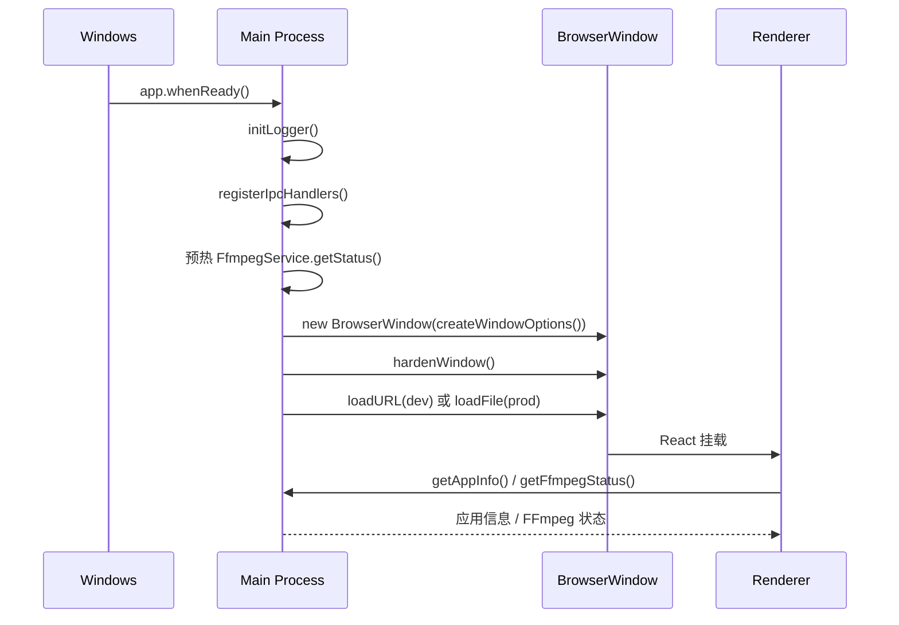
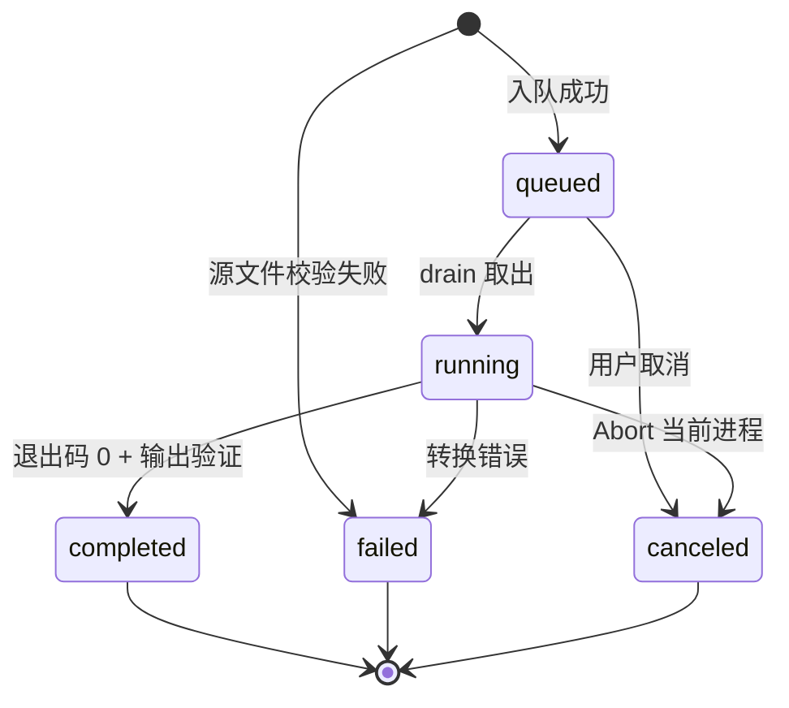

# FrameForge（帧铸）开发者实现教程

> 这份文档面向要接手、讲解或继续开发 FrameForge 的人。目标不是重复 README 的功能列表，而是把“用户点一下按钮之后，代码到底发生了什么”讲清楚。
>
> 当前基线：**阶段 4（功能型产品体验）、M1（Windows 最小可交付基线）、M2（格式能力层 + WebM/MP3）和 M3（高级设置 + 命令预览 + 动态 ETA）已完成**。FFmpeg 已随安装包分发，安装版在移除系统 PATH 后仍能真实转换；WebM/MP3、高级设置和 ETA 已通过真实 FFmpeg、FFprobe、自动化测试和打包版 E2E。视觉方向还没有最终确定。
>
> 阅读原则：本文只把已经写入代码、已经运行过的能力写成“已实现”；属于 M5/M6 的计划会明确标注为“待完成”。M5 视觉方向等开发者验收 M4 后再确定。

### 阅读地图

- **想先看懂整体**：第 1–4 节（心智模型、技术栈、进程边界、启动流程）。
- **想跟一次真实导入**：第 5–6 节（IPC、文件选择/拖拽、FFprobe、缩略图）。
- **想跟一次真实转换**：第 7–10 节（参数、队列、runner、进度、FFmpeg 定位）。
- **想看 UI 和安全**：第 11–13 节（React 状态、安全边界、日志）。
- **想看怎么证明能用**：第 14–15 节（测试、构建、打包）。
- **想按路线读代码**：第 16 节。
- **想交给编码模型重做**：第 17 节。
- **想准备演示/面试**：第 18 节。
- **查术语和文件**：第 19–22 节及附录。

---

## 1. 先建立一个心智模型

FrameForge 可以拆成四层：

```text
Electron 桌面壳
  └─ React 工作台（renderer）
       └─ 受控 preload 桥
            └─ Electron 主进程服务层
                 └─ 真实 ffmpeg / ffprobe 子进程
```

一句话概括：

> **React 只负责界面和用户交互；文件系统、FFmpeg 路径、媒体探测、缩略图、转换队列和子进程生命周期全部在主进程完成。**

用户看到的主链路是：

```text
导入视频
  → ffprobe 读取真实元数据
  → ffmpeg 抽取真实缩略图
  → 选择输出格式 / 质量 / 输出目录
  → 串行队列启动真实 ffmpeg
  → 从 stdout 解析真实进度
  → 校验输出文件
  → 打开文件或所在目录
```

这条链路不是用假数据模拟的。测试和打包版验证都实际启动过本机 FFmpeg。

### 1.1 和原始题目逐条对照

| 原始要求 | 当前实现 | 状态 |
|---|---|---|
| 加载视频信息并显示 | 主进程调用 `ffprobe`，解析时长、分辨率、帧率、容器、编码、文件大小 | 已实现，真实文件验证通过 |
| 获取并显示缩略图 | 主进程调用 `ffmpeg` 抽单帧，输出 320×180 JPEG，以 data URL 交给 UI | 已实现，缩略图失败可降级 |
| 用 FFmpeg 命令行转换 | `spawn(executablePath, args, { shell: false })`，参数数组构造 | 已实现，MP4/MKV/WebM/MP3 真实转换通过 |
| 自己做一些优化 | 串行队列、临时文件、冲突避让、取消、拖拽、快捷键、关闭保护、错误复制、日志、真实编码器能力探测 | 已实现 |
| 会话总结与开发者决策记录 | `docs/AI_DEVELOPMENT_LOG.md` 记录每阶段决策、反馈、RED/GREEN；`docs/SESSION_SUMMARY.md` 已更新到 M2 | 已有总结；M6 更新最终版 |
| 项目提交 GitHub | 已有基线提交 `87d5395`、`1f74c6d` 推送到 `origin/main`；M1 基线为 `0681c38`；M2 已本地提交，推送待网络恢复 | 进行中 |
| 界面选型与“客户端”关联 | Electron 桌面窗口、原生文件/目录选择器、本地路径、真实子进程 | 客户端关联已成立；整体视觉方向待确认 |
| 设计给人用、自己测试过 | 140 个自动化测试、真实 FFmpeg 集成、无 PATH 的目录版/安装版 E2E、截图和证据日志 | 核心功能和 Windows 打包版已验证；独立干净 VM 和卸载待 M6 |

这张表很重要：它既说明项目做了什么，也说明现在还**不能**对外宣称什么。面试或答辩时，边界要讲清楚。

---

## 2. 技术栈与选型理由

| 层 | 技术 | 在当前项目中的职责 |
|---|---|---|
| 桌面运行时 | Electron 45 | 创建 Windows 窗口、系统对话框、剪贴板、Shell、生命周期 |
| UI | React 19 + TypeScript 5.9 | 工作台、媒体列表、设置、队列、错误状态 |
| 构建 | electron-vite 6 + Vite 8 | 分别构建 main / preload / renderer |
| 样式 | Tailwind CSS 4 | 布局、间距、颜色、响应式 |
| 图标 | lucide-react | 统一的线性图标 |
| 测试 | Vitest 5 + Testing Library | 纯函数、服务、IPC、React UI、真实进程集成 |
| 打包 | electron-builder 26 | 生成 Windows 目录版、NSIS 安装包和完整目录 zip |
| 媒体探测 | `ffprobe` CLI | JSON 元数据 |
| 媒体处理 | `ffmpeg` CLI | 缩略图、转码、进度输出 |
| 日志 | electron-log 5 | 控制台 + 文件日志 |

### 为什么是 Electron，而不是纯 Web

题目明确要求“客户端关联”。如果只做一个浏览器页面，即使 FFmpeg 跑在服务器上，也不能算桌面客户端。

Electron 在这个项目里提供了四件浏览器做不到或做不好的事：

1. 打开 Windows 原生文件选择器和目录选择器；
2. 直接读取用户本地的绝对路径；
3. 在主进程启动并管理本地 `ffmpeg.exe` / `ffprobe.exe`；
4. 在窗口关闭、任务取消等桌面生命周期事件里做资源清理。

Electron 不是唯一方案，Tauri 也合理。这个项目选 Electron 的原因是：三天限时内，React/TypeScript 与 Node 子进程管理的熟悉度更高，交付概率更大。这是一个工程取舍，不是“Electron 绝对更好”。

### 为什么 renderer 不能直接调用 FFmpeg

如果把 `child_process` 或 `fs` 暴露给 React：

- 任何页面脚本都能执行任意命令或读写任意文件；
- React 组件卸载可能导致任务状态丢失；
- UI 线程会被文件操作和进程管理拖慢；
- 测试时很难把界面和真实系统解耦。

所以当前架构把“界面”和“系统能力”硬分开。这是理解整个项目的关键。

---

## 3. 进程边界：谁负责什么


| 层 | 主要文件 | 可以做什么 | 不可以做什么 |
|---|---|---|---|
| Renderer | `src/App.tsx`、`src/components/*` | 维护 UI 状态、调用 `window.desktopAPI`、渲染界面 | 不能导入 `node:fs`、`node:child_process`、Electron 模块 |
| Preload | `electron/preload/index.ts`、`api.ts` | 通过 `contextBridge` 暴露 19 个受控方法 | 不能暴露完整 `ipcRenderer`、`fs`、通用命令执行 |
| Main | `electron/main/*`、`services/*` | 文件对话框、FFprobe/FFmpeg、队列、日志、系统 Shell | 不能把 DOM/React 逻辑塞进来 |
| 外部进程 | `ffmpeg.exe`、`ffprobe.exe` | 探测、缩略图、转码 | 不通过 shell 解释参数 |

### 3.1 共享契约

`shared/` 下的文件同时被 main、preload、renderer 引用，但它们**不导入 Node/Electron 模块**：

- `shared/ipc.ts`：IPC 通道名、`DesktopAPI` 类型、`DESKTOP_API_KEYS`；
- `shared/media.ts`：视频扩展名、`MediaMetadata`、`MediaItem`、`FfmpegStatus`；
- `shared/conversion.ts`：输出格式、质量预设、高级设置模型、任务状态、`ConversionJob`、`ConversionUpdate`；
- `shared/conversion-args.ts`：唯一 FFmpeg 参数构造和命令预览格式化，执行与 renderer 预览共用；
- `shared/media-format.ts`：时长、帧率、文件大小、分辨率的展示格式化。

这样做的价值是：主进程和 UI 对“什么是一个任务”“什么是一个媒体项”有同一份类型定义，减少接口拼错。

---

## 4. 应用启动时发生了什么

### 4.1 入口编排

`electron/main/index.ts` 的 `main()` 只负责顺序和顶层错误处理：

```ts
async function main(): Promise<void> {
  await app.whenReady();
  logger.info('FrameForge starting', { ... });

  await runMain({
    initLogger,
    registerIpcHandlers: () => {
      const registered = registerIpcHandlers(() => mainWindow);
      conversionQueue = registered.conversion;
    },
    createMainWindow,
    registerAppLifecycle,
  });

  logger.info('FrameForge startup complete');
}
```

`electron/main/orchestrator.ts` 把启动顺序抽成一个可测试的函数：

```ts
export async function runMain(dependencies: MainDependencies): Promise<void> {
  await dependencies.initLogger();
  dependencies.registerIpcHandlers();
  await dependencies.createMainWindow();
  dependencies.registerAppLifecycle();
}
```

这个拆分看起来很小，但很重要：启动顺序可以被单元测试，不需要真的启动 Electron 窗口。

### 4.2 启动顺序



`registerIpcHandlers()` 不只是注册通道，它还负责组装服务：

- `FfmpegService`：解析路径并真实执行 `-version`；
- `MediaService`：导入时调用 FFprobe + 缩略图；
- `ConversionQueue`：串行执行转换任务；
- `sendConversionUpdate()`：把主进程的任务更新推给主窗口。

启动时会预热一次 FFmpeg 状态，避免 UI 第一次请求时才发现环境问题。

### 4.3 窗口安全配置

`electron/main/window-options.ts` 中的关键配置：

```ts
webPreferences: {
  preload: input.preloadPath,
  contextIsolation: true,
  nodeIntegration: false,
  sandbox: true,
  webSecurity: true,
  devTools: !input.isPackaged,
}
```

`electron/main/security.ts` 还会：

- 拒绝 `window.open()` 新窗口；
- 拦截不在允许范围内的 `will-navigate` 导航。

这保证 renderer 不能加载远程页面，也不能通过新窗口绕过限制。

---

## 5. IPC：界面和主进程之间的唯一通道

### 5.1 19 个受控方法

`shared/ipc.ts` 定义了 `DesktopAPI`。preload 只暴露这些方法：

| 方法 | IPC 通道 | 作用 |
|---|---|---|
| `getAppInfo()` | `app:get-info` | 应用版本、Electron/Chrome/Node 版本、平台 |
| `getFfmpegStatus()` | `ffmpeg:get-status` | 返回真实 FFmpeg/FFprobe 是否可用、版本、来源 |
| `getConversionCapabilities()` | `conversion:get-capabilities` | 真实执行 `ffmpeg -encoders`，返回编码器和格式可用性 |
| `selectVideos()` | `media:select-videos` | 打开系统多选文件对话框，导入并探测 |
| `importVideos(paths)` | `media:import-paths` | 接收拖拽路径，校验后导入 |
| `getPathForFile(file)` | 不走 IPC | preload 里用 `webUtils.getPathForFile` 取本地路径 |
| `selectOutputDirectory()` | `conversion:select-output-directory` | 打开系统目录选择器 |
| `startConversions(request)` | `conversion:start` | 创建任务并启动串行队列 |
| `cancelConversion(jobId)` | `conversion:cancel` | 取消排队/运行任务 |
| `onConversionUpdate(callback)` | `conversion:update` | 订阅主进程推送的任务状态 |
| `openOutputFile(jobId)` | `shell:open-output-file` | 打开已完成任务的输出文件 |
| `showOutputInFolder(jobId)` | `shell:show-output-in-folder` | 在资源管理器中定位输出文件 |
| `getConversionHistory()` | `history:list` | 读取主进程持久化的终端态历史 |
| `clearConversionHistory()` | `history:clear` | 清空历史记录，不删除输出文件 |
| `onHistoryUpdated(callback)` | `history:updated` | 订阅终态历史新增事件 |
| `openHistoryOutput(historyId)` | `shell:open-history-output` | 用历史记录 ID 打开输出文件 |
| `showHistoryOutputInFolder(historyId)` | `shell:show-history-output-in-folder` | 用历史记录 ID 定位输出文件 |
| `copyText(text)` | `clipboard:write-text` | 受控写入剪贴板 |
| `openLogDirectory()` | `shell:open-log-directory` | 打开主进程日志目录 |

### 5.2 `invoke` 与事件订阅

- “请求—响应”型操作使用 `ipcRenderer.invoke` / `ipcMain.handle`，例如选择文件、开始转换。
- “主进程主动推送”使用 `webContents.send`，renderer 通过 `onConversionUpdate` 和 `onHistoryUpdated` 订阅。

订阅函数必须返回取消订阅函数：

```ts
onConversionUpdate: (callback) =>
  subscribe(IPC_CHANNELS.conversionUpdate, (payload) => {
    callback(payload as ConversionUpdate);
  }),
```

React 组件卸载时必须调用返回的函数，避免重复监听和内存泄漏。`App.tsx` 在 `useEffect` 的清理函数里做了这件事。

### 5.3 IPC 参数校验

Renderer 不是可信边界。主进程在进入业务逻辑前会做多层校验：

| 入口 | 校验 |
|---|---|
| 所有 IPC | `event.sender.id` 必须等于当前主窗口的 `webContents.id` |
| 拖拽导入 | 必须是数组、最多 100 个、绝对路径、已知视频扩展名、大小写不敏感去重 |
| 转换请求 | 最多 100 个源文件、绝对路径、已知格式/预设、绝对输出目录 |
| 取消/打开输出 | 任务 ID 必须是非空字符串且不超过 200 字符 |
| 历史读取/清空/打开 | 历史 ID 必须是非空字符串且不超过 200 字符；打开时主进程重新读取历史并校验输出存在 |
| 复制文本 | 非空、最多 20,000 字符 |
| 打开输出 | 只接受任务 ID；主进程从队列取真实输出路径，再检查任务状态和文件存在性 |
| 打开日志目录 | 路径由主进程根据日志文件位置决定，renderer 不能传入路径 |

真正的文件和媒体合法性还会在 `validateVideoPath()`、`validateOutputDirectory()` 和 FFprobe 阶段再次验证。IPC 校验只是第一道门。

---

## 6. 视频导入与元数据链路

### 6.1 两个入口

**系统文件选择器**

`App.tsx` 的 `handleImport()` → `api.selectVideos()` → 主进程 `dialog.showOpenDialog()` → `MediaService.importFiles()`。

**拖拽**

`App.tsx` 的 `handleDrop()` 从 `event.dataTransfer.files` 取文件，然后调用：

```ts
const paths = files
  .map((file) => api.getPathForFile(file))
  .filter((path) => Boolean(path));
```

`getPathForFile` 在 preload 中使用 Electron 的 `webUtils.getPathForFile(file)`，而不是旧教程里常见的 `File.path`。后者在现代 Electron 中不可靠。

拿到路径后走 `importVideos(paths)`，主进程再用 `parseVideoPaths()` 校验一次。

### 6.2 导入编排

`electron/main/services/media/media-service.ts` 对每个文件独立执行：

```text
validateVideoPath()
  → probeMedia()        // ffprobe
  → extractThumbnail()  // ffmpeg
  → 组装 MediaItem
```

关键设计是**错误隔离**：

- 元数据失败：该文件标记为 `error`，`metadata` 为 `null`，不能转换；
- 缩略图失败：只写 `thumbnailError`，`metadata` 保留，文件仍然可以转换；
- 一个文件失败不会影响同批其他文件。

`MediaItem` 的定义在 `shared/media.ts`：

```ts
interface MediaItem {
  path: string;
  fileName: string;
  metadata: MediaMetadata | null;
  thumbnailDataUrl: string | null;
  thumbnailError: string | null;
  error: string | null;
}
```

### 6.3 路径校验

`validateVideoPath()` 只接受：

- 绝对路径；
- 真实存在；
- 是普通文件，不是目录；
- 扩展名在 `VIDEO_EXTENSIONS` 中；
- 当前用户可读。

扩展名列表包括 `mp4`、`m4v`、`mov`、`mkv`、`webm`、`avi`、`wmv`、`flv`、`mpg`、`mpeg`、`ts`、`m2ts`、`3gp`。

扩展名校验只是快速过滤，真正的“这是不是一个视频”仍由 FFprobe 判断。

### 6.4 FFprobe 读取元数据

实际执行的是：

```powershell
ffprobe -v error -print_format json -show_format -show_streams -i "D:\素材\测试 视频.mp4"
```

参数以数组传入，路径里的空格和中文不会被 shell 拆分。

`parseFfprobeJson()` 是纯函数，负责：

1. 解析 JSON；
2. 找到第一个 `codec_type === 'video'` 且不是封面图的流；
3. 读取第一个音频流，决定 `hasAudio`；
4. 从 `format.duration` 或视频流 `duration` 取时长；
5. 从 `r_frame_rate` 或 `avg_frame_rate` 取帧率；
6. 归一化容器名和编码名；
7. 对缺失字段返回 `null`，而不是编造默认值。

如果文件没有视频轨道，会抛出 `MediaProbeError: 文件中没有视频轨道`。

### 6.5 FFmpeg 生成缩略图

缩略图不是用 canvas 截 UI，而是真实抽帧：

```powershell
ffmpeg -v error -y -ss 1 -i "D:\素材\测试 视频.mp4" -an -sn -frames:v 1 `
  -vf "scale=320:180:force_original_aspect_ratio=decrease,pad=320:180:(ow-iw)/2:(oh-ih)/2:color=black" `
  -q:v 3 -update 1 "C:\Temp\frameforge-thumbnails\thumb-xxxx.jpg"
```

规则：

- 时长 ≥ 2 秒：优先从第 1 秒抽帧；
- 短视频：直接从第 0 帧抽；
- 如果第 1 秒抽帧失败，会降级重试第 0 帧；
- 输出统一 320×180，保持比例并用黑边补齐；
- 读取临时 JPEG，转成 `data:image/jpeg;base64,...` 返回；
- 无论成功失败，`finally` 都删除临时文件。

缩略图失败不会让导入失败，这是有意的产品取舍。

### 6.6 UI 如何合并导入结果

`App.tsx` 的 `mergeMediaItems()` 按绝对路径去重：

```ts
const byPath = new Map(current.map((item) => [item.path, item]));
for (const item of incoming) {
  if (!byPath.has(item.path)) {
    byPath.set(item.path, item);
  }
}
```

重复拖入同一个文件不会出现第二张卡片。

`MediaCard` 会显示：

- 缩略图或“暂无缩略图”占位；
- 文件名和完整路径（悬停可看）；
- 时长、分辨率、帧率；
- 容器、视频编码、音频编码或“无音轨”；
- 文件大小；
- 元数据读取失败原因；
- 缩略图失败原因（黄色提示，不影响转换）。

---

## 7. 转换设置与 FFmpeg 参数

### 7.1 输出格式与能力探测

当前开放四种输出 profile，全部由 `shared/conversion.ts` 的 `OUTPUT_PROFILES` 描述：

| 格式 | 扩展名 | 视频编码 | 音频编码 | 特点 |
|---|---|---|---|---|
| MP4 | `.mp4` | H.264 | AAC | 兼容性最好，适合分享 |
| MKV | `.mkv` | H.264 | AAC | 开放容器，适合后续处理 |
| WebM | `.webm` | VP9 | Opus | 适合网页和开放容器 |
| MP3 | `.mp3` | 无 | MP3 | 只导出音频，不生成视频轨 |

UI、参数构造、扩展名和能力检测都读取同一份 profile，不在组件里写 `if (format === ...)` 的格式特判。

启动时 `FfmpegCapabilityService` 会真实执行：

```text
ffmpeg -hide_banner -encoders
```

然后解析 `libx264`、`aac`、`libvpx-vp9`、`libopus`、`libmp3lame` 是否存在：

- MP4 / MKV 需要 `libx264` + `aac`；
- WebM 需要 `libvpx-vp9` + `libopus`；
- MP3 需要 `libmp3lame`。

缺失编码器的格式会在 UI 中禁用并显示原因。FFmpeg 不可用或输出解析失败时返回全 false，不会把“未知”显示成“可用”。成功结果会缓存；失败结果不永久缓存，下一次请求会重新检测。

没有开放 H.265、MOV、GIF、AV1；这些格式不在当前 P0/P1 范围。

### 7.2 质量预设

同一套质量预设按 profile 映射到不同的编码参数（`shared/conversion.ts`）：

| 预设 | H.264 CRF | VP9 CRF | 音频码率 | 说明 |
|---|---:|---:|---:|---|
| `compatible` 兼容优先 | 23 | 32 | 192 kbps | 默认，兼容性与体积平衡 |
| `quality` 质量优先 | 20 | 28 | 256 kbps | 画质更好，文件更大 |
| `compact` 体积优先 | 28 | 36 | 128 kbps | 文件更小，画质下降 |

CRF 是恒定质量参数，数值越小质量越高、文件越大。VP9 的 CRF 标尺与 x264 不同，所以使用另一组数值；WebM 还使用 `-b:v 0` 开启纯恒定质量模式。

MP3 没有视频 CRF，只使用音频码率。UI 在 MP3 下显示“音频质量”，不再展示视频 CRF 文案。

### 7.3 参数构造

真正实现位于 `shared/conversion-args.ts` 的 `buildConversionArgs()`，主进程 `conversion/args.ts` 只重新导出。参数数组不拼接 shell 字符串；renderer 的命令预览也调用同一个函数，因此不会出现“预览一套、执行另一套”。

公共部分：

```text
-hide_banner -v error -y
-i <input>
-stats_period 0.2 -progress pipe:1 -nostats
<output>
```

视频格式（MP4 / MKV / WebM）先取第一条视频流并禁用字幕：

```text
-map 0:v:0 -sn
```

有音轨时：

```text
-map 0:a:0? -c:a <aac|libopus> -b:a <192|256|128>k
```

无音轨或用户选择“移除音轨”时明确写 `-an`，不会凭空生成音轨。

高级设置覆盖默认参数：

```text
# 分辨率非 original 且源高度大于目标高度时
-vf scale=-2:<1080|720|480>:flags=lanczos

# 自定义 CRF（18–30）
-crf <18..30>

# 自定义音频码率（128/192/256 kbps）
-b:a <128|192|256>k
```

`scale=-2` 保证宽度是偶数；源视频高度不超过目标时完全不添加 `-vf`，避免放大。MP3 不允许“移除音轨”。

视频编码按 profile 分支：

```text
# MP4 / MKV
-c:v libx264 -preset medium -crf <23|20|28> -pix_fmt yuv420p

# WebM
-c:v libvpx-vp9 -crf <32|28|36> -pix_fmt yuv420p `
-b:v 0 -deadline good -cpu-used 4 -row-mt 1
```

MP4 额外加 `-movflags +faststart`，把索引放到文件头；MKV/WebM 不加。

MP3 是另一条明确分支：

```text
-vn
-map 0:a:0
-c:a libmp3lame
-b:a <192|256|128>k
```

MP3 不构造 `-map 0:v:0`，也不构造视频编码参数；无音轨源会在入队阶段直接失败，不会启动 FFmpeg。

一个等价的 MP4 命令行示例（仅用于理解，实际代码使用参数数组）：

```powershell
ffmpeg -hide_banner -v error -y `
  -i "D:\素材\测试 视频.mp4" `
  -map 0:v:0 -sn `
  -map 0:a:0? -c:a aac -b:a 192k `
  -c:v libx264 -preset medium -crf 23 -pix_fmt yuv420p `
  -movflags +faststart `
  -stats_period 0.2 -progress pipe:1 -nostats `
  "D:\输出\测试 视频_converted.mp4"
```

WebM 示例：

```powershell
ffmpeg -hide_banner -v error -y `
  -i "D:\素材\测试 视频.mp4" `
  -map 0:v:0 -sn `
  -map 0:a:0? -c:a libopus -b:a 192k `
  -c:v libvpx-vp9 -crf 32 -pix_fmt yuv420p `
  -b:v 0 -deadline good -cpu-used 4 -row-mt 1 `
  -stats_period 0.2 -progress pipe:1 -nostats `
  "D:\输出\测试 视频_converted.webm"
```

MP3 示例：

```powershell
ffmpeg -hide_banner -v error -y `
  -i "D:\素材\测试 视频.mp4" `
  -vn -map 0:a:0 `
  -c:a libmp3lame -b:a 192k `
  -stats_period 0.2 -progress pipe:1 -nostats `
  "D:\输出\测试 视频_converted.mp3"
```

逐个解释：

- `-map 0:v:0`：只取第一条视频流，不复制所有轨道；
- `-sn`：不保留字幕轨；
- `-map 0:a:0?`：取第一条音频流，`?` 表示没有音频也不报错；
- `-c:a aac|libopus|libmp3lame`：由 profile 决定音频编码器；
- `-c:v libx264|libvpx-vp9`：由 profile 决定视频编码器；
- `-preset medium`：x264 速度/压缩率平衡；VP9 使用 `-deadline good -cpu-used 4`；
- `-crf`：质量预设，H.264 和 VP9 使用不同数值；
- `-b:v 0`：VP9 纯恒定质量模式；
- `-pix_fmt yuv420p`：提高播放器兼容性；
- `-movflags +faststart`：只对 MP4 使用；
- `-stats_period 0.2`：缩短进度刷新间隔，短视频也能看到中间进度；
- `-progress pipe:1`：把结构化进度写到 stdout；
- `-nostats`：关闭 stderr 的冗长统计。

### 7.4 为什么不允许 renderer 传自定义参数

如果开放“自定义 FFmpeg 参数”，就等于给页面一个任意命令执行入口。用户或恶意脚本可以传 `-f`、任意输入输出路径、滤镜甚至其他协议。

当前设计把“用户能选什么”限制为：

- 输出格式：MP4 / MKV / WebM / MP3；
- 质量预设：三档；
- 输出目录：系统目录选择器；
- 源文件：经过校验的本地视频路径。

FFmpeg 参数完全由主进程根据这些枚举值和能力矩阵构造。格式更多了，但安全边界仍然清楚。

### 7.5 输出命名与冲突

`electron/main/services/conversion/output.ts` 负责：

```text
第一次：原名称_converted.<ext>
冲突：原名称_converted (1).<ext>
再冲突：原名称_converted (2).<ext>
...
最多尝试 1000 次
```

同时，队列还会维护 `reservedOutputPaths`，避免同一批任务里两个文件在“文件还没真正生成”时抢到同一个名字。

输出目录也会先校验：

- 非空；
- 绝对路径；
- 存在；
- 是目录；
- 当前用户可写。

### 7.6 临时文件

转换不会直接写最终文件，而是先写同目录的：

```text
原名称_converted.part-<jobId>.mp4
```

临时文件必须保留目标扩展名，否则 FFmpeg 可能选错 muxer。

成功后才 `rename` 到最终路径。失败或取消时在 `finally` 中删除临时文件。

---

## 8. 串行转换队列

### 8.1 状态机

`ConversionJobStatus` 有五种状态：

```text
queued → running → completed
  │         │
  │         ├→ failed
  │         └→ canceled
  └→ canceled
```

非法源文件不会进入 `queued`，而是直接创建一个 `failed` 任务，仍然会出现在队列里，让用户知道哪个文件失败以及为什么。



### 8.2 `enqueue()` 做了什么

`electron/main/services/conversion/queue.ts` 的 `enqueue()`：

1. 校验格式和质量预设；
2. 校验源路径数组非空、最多 100 个；
3. 校验输出目录；
4. 对源路径去重（大小写不敏感）；
5. 逐个校验源文件；仅音频格式（MP3）额外用真实 FFprobe 检查 `hasAudio`，无音轨直接失败，不启动 FFmpeg；
6. 为每个有效源文件找不冲突的输出名；
7. 预占输出名；
8. 创建 `queued` 任务，保存该任务的设置快照；
9. 通过 `onUpdate` 推送任务；
10. 调用 `drain()`，异步开始执行。

`enqueue()` 返回创建的任务数组，UI 用它补充队列。注意：主进程可能在 `enqueue()` 返回之前就已经推送了 `running` 或 `completed` 事件，所以 UI 不能简单用返回值覆盖现有状态。

### 8.3 `drain()` 的串行循环

核心逻辑可以简化成：

```ts
while (true) {
  const job = jobs.find((candidate) => candidate.status === 'queued');
  if (!job) break;

  job.status = 'running';
  const controller = new AbortController();
  active = { jobId: job.id, controller };

  try {
    const result = await runJob(job, settings, {
      signal: controller.signal,
      onProgress: (progress) => {
        job.progress = clamp(progress, 0, 99);
        emit(job);
      },
    });

    job.outputPath = result.outputPath;
    job.progress = 100; // runner 已通过退出码 + 文件 + FFprobe 编码校验
    job.status = 'completed';
  } catch (error) {
    // 取消 → canceled；其他错误 → failed
  } finally {
    active = null;
    emit(job);
  }
}
```

关键点：

- **严格串行**：同一时间只有一个 FFmpeg 转换进程；
- **失败隔离**：一个任务失败不会清空后面的任务；
- **取消只影响当前任务**：排队任务可以直接标记取消，运行任务通过 `AbortController` 终止；
- **设置快照**：每个任务入队时保存自己的格式、预设、输出目录，运行中修改 UI 不会改变已入队任务；
- **输出名预占**：避免同批任务在文件生成前抢名；
- **进度封顶 99%**：真正的 100% 只在任务成功返回后设置。

### 8.4 取消

`cancel(jobId)` 分两种情况：

- `queued`：直接把状态改成 `canceled`，删除设置，发出更新；
- `running`：调用当前任务的 `AbortController.abort()`。

`runProcess` 收到 abort 后会：

1. 调用 `child.kill()`；
2. 等 `close` 事件确认进程退出；
3. 如果 3 秒内没有退出，用兜底定时器结束等待并抛出 `ABORTED`。

队列把 `ABORTED` 或 `ConversionCanceledError` 映射为 `canceled`，runner 在 `finally` 中删除临时文件。

### 8.5 关闭窗口保护

`electron/main/services/close-guard.ts` 负责：

```text
窗口 close
  → 有 queued/running 任务？
      → 弹原生确认框
          → 用户选择“取消任务并退出”
              → cancelAll()
              → waitForIdle()
              → 真正 close
          → 用户选择“继续转换”
              → 阻止关闭
      → 没有任务：直接关闭
```

这不是“假装关闭保护”。它会等待真实子进程退出和临时文件清理完成。

### 8.6 UI 的事件竞态

`App.tsx` 有两个合并函数：

- `upsertConversionJob()`：按 job id 新增或替换；
- `mergeStartedJobs()`：只补充 `startConversions` 返回值里 UI 还不知道的任务。

原因是主进程事件可能先于 `startConversions` 的 Promise 返回值到达。如果 UI 直接用返回值覆盖整个数组，就可能把已经变成 `running` 或 `completed` 的任务回退成 `queued`。

### 8.7 转换历史为什么由主进程持久化

历史不是 renderer 的 localStorage，也不是队列快照。链路是：

```text
队列进入完成/失败/取消终态
  → onTerminal(job, settings)
  → ConversionHistoryStore.record()
  → 内存去重 + 排序 + 200 条上限
  → 写 conversion-history.json.tmp
  → rename 覆盖 conversion-history.json
  → webContents.send('history:updated', entry)
  → App 按 id 合并到右侧栏 HistoryCard
```

几个容易踩错的点：

- **只记录终态**：`queued`/`running` 不写历史，否则重启后会恢复一批永远不会继续的任务。
- **终态只通知一次**：队列有 `terminalNotified` 集合，取消和自然结束竞争时不会写两条记录。
- **历史 ID 不是任务 ID**：历史记录生成独立 `history-*` ID。应用重启后旧队列任务 ID 失效，历史动作只接受历史 ID，避免误操作新会话里复用的 `job-1`。
- **去重键是队列 job ID**：同一会话内即使重复收到终态通知，也不会写入第二条；不同会话的 job ID 可以复用，但历史 ID 不会复用。
- **原子写**：先写临时文件再 rename；写到一半崩溃不会留下半个 JSON。读取时如果 JSON 损坏，会备份成 `.corrupt-*` 并返回空历史，不阻塞应用启动。
- **清空不删文件**：`clear()` 只把 history 文件写成空数组；输出文件属于用户资产，历史删除不能级联删除。
- **启动读取与推送可能并发**：`App` 不直接用 `getConversionHistory()` 结果覆盖当前列表，而是用 `mergeHistoryEntries()` 逐条合并，避免晚到的旧快照把刚推送的新记录覆盖掉。

`ConversionHistoryStore` 的状态在 `electron/main/services/history/store.ts`。它只依赖注入的 `readFile`/`writeFile`/`rename`/`access` 等函数，所以测试可以在真实临时目录里验证原子写入、损坏回退和跨实例恢复，而不需要启动 Electron。

---

## 9. 单个转换任务真正做了什么

`electron/main/services/conversion/runner.ts` 的 `ConversionRunner.run()` 是核心执行器。

### 9.1 执行步骤

```text
1. 读取 FFmpeg 状态
2. 重新 probe 源文件，拿到准确时长和 hasAudio
3. 生成临时输出路径
4. 创建进度解析器
5. 构造 FFmpeg 参数
6. spawn 执行，stdout 流式喂给解析器
7. 检查是否被取消
8. 检查临时文件大小 > 0
9. 检查最终输出路径不存在（防止覆盖）
10. rename 临时文件 → 最终文件
11. 检查最终文件大小 > 0
12. 用随包 FFprobe 校验输出编码/轨道与所选 profile 一致
13. 校验失败时删除最终输出并抛错
14. 返回 outputPath
15. finally 删除临时文件
```

为什么启动时要重新 probe，而不是直接复用导入时的 metadata？

- 导入到开始转换之间，源文件可能被替换或修改；
- `hasAudio` 决定是否传 `-an`，必须准确；
- 时长决定进度分母，必须准确；
- 重新 probe 让单个任务具备自洽性，而不是依赖 UI 缓存。

### 9.2 进度解析

FFmpeg 的 `-progress pipe:1` 输出类似：

```text
frame=123
fps=25.0
out_time_us=4000000
out_time_ms=4000000
out_time=00:00:04.000000
progress=continue
...
progress=end
```

`electron/main/services/conversion/progress.ts` 处理：

- `out_time_us` 和 `out_time_ms` 都按**微秒**解释（后者名称有历史歧义）；
- `out_time=HH:MM:SS.ffffff` 也会解析；
- stdout chunk 可能跨行，解析器内部维护 buffer；
- 进度 = 输出时间 / 源时长；
- 结果限制在 0–99，且只允许递增；
- 100 由队列在输出文件验证后设置；
- `speed=1.23x` 只取真实值，忽略 `N/A`；
- 最近 5 个 speed 样本取平均；不足两个样本时 ETA 为 null，UI 显示“估算中”；
- `剩余时间 = (源时长 - 输出时间) / 平滑 speed`；
- 队列把 `speed`、`etaSeconds`、`elapsedMs` 写入任务；完成/取消/失败后清除 speed/ETA。

所以 UI 上的百分比和剩余时间来自真实 FFmpeg 输出，不是 `setInterval` 假进度或假倒计时。

### 9.3 成功的定义

任务只有在以下条件全部满足时才标记 `completed`：

1. FFmpeg 进程退出码为 0；
2. 临时输出文件存在且大小 > 0；
3. 最终输出路径在 rename 前不存在；
4. rename 成功；
5. 最终输出文件存在且大小 > 0；
6. FFprobe 输出与 profile 一致：
   - 视频输出必须包含视频轨，编码等于 H.264 或 VP9；
   - 源文件有音轨时，输出必须包含预期音频编码（AAC / Opus）；
   - 源文件无音轨时，输出不能凭空多出音轨；
   - MP3 必须只有音频、没有视频轨；
   - 输出时长不能为 0。

任何一步失败都会进入失败/取消分支，临时文件在 `finally` 中清理；输出编码校验失败时还会删除已经 rename 的最终文件，避免把坏输出留给用户。

### 9.4 错误与日志摘要

- `ProcessError`：进程启动失败、非零退出、超时、取消；
- `MediaProbeError`：源文件探测失败；
- `ThumbnailError`：缩略图失败（可降级）；
- `ConversionError`：转换失败，带 `logExcerpt`；
- `ConversionCanceledError`：用户取消。

失败任务的 `logExcerpt` 来自 FFmpeg stderr，UI 可以展开“查看详细日志”，也可以“复制错误”到剪贴板。

---

## 10. FFmpeg 定位与状态

### 10.1 查找顺序

`electron/main/services/ffmpeg/resolver.ts` 按以下顺序查找：

1. `FRAMEFORGE_FFMPEG_DIR` 环境变量；
2. 随包目录，按平台/架构分层：
   - 打包模式：`process.resourcesPath/ffmpeg/<platform>-<arch>/`
   - 开发模式：`<项目根>/resources/ffmpeg/<platform>-<arch>/`
3. 旧的平铺随包目录：`resources/ffmpeg/`（兼容旧产物）；
4. 系统 `PATH` 中的每个目录。

`layout.ts` 负责生成候选目录，resolver 负责成对校验。只有在**同一目录**下同时存在 `ffmpeg` 和 `ffprobe` 才算一个候选。这样避免把两个版本不匹配的二进制拼在一起。

Windows 下会自动加 `.exe` 后缀。

### 10.2 真实可用性检查

`FfmpegService.getStatus()` 不只是看文件是否存在，还会真实执行：

```text
ffmpeg -version
ffprobe -version
```

两个命令都成功且能解析出版本号，才返回 `available: true`。

状态会缓存。启动预热和 renderer 首次请求可能同时发生，`FfmpegService` 用 `pending` Promise 共享同一次检测，避免启动两对进程。

### 10.3 随包状态

- 安装包内置 `ffmpeg 8.0.1-full_build-www.gyan.dev` Windows x64 shared build；
- 随包目录包含 `ffmpeg.exe`、`ffprobe.exe`、全部依赖 DLL、`LICENSE`、`README.txt` 和 `bundle-manifest.json`；
- 打包版和安装版在移除 `PATH`、`FRAMEFORGE_FFMPEG_DIR` 后，状态返回 `source: "bundled"`；
- 当前构建是 GPLv3 构建（`--enable-gpl --enable-version3`），正式分发前仍需核对许可证和源码提供方式。

可复现的验证见 `docs/TEST_PLAN.md` 和 `scripts/e2e-packaged.mjs`。

---

## 11. Renderer：工作台如何组织

### 11.1 页面结构

`src/App.tsx` 是唯一的工作台编排组件，布局在 `AppShell` 内：

```text
┌──────────────────────────────────────────────────────────────┐
│ AppShell：产品名 / 本地处理说明 / FFmpeg 状态               │
├───────────────────────────────────┬──────────────────────────┤
│ 媒体列表                           │ 转换设置                 │
│ - EmptyState（空状态）             │ - 格式 / 质量 / 输出目录 │
│ - MediaList（已导入文件）          │ - 开始转换               │
│                                   ├──────────────────────────┤
│                                   │ JobQueue（任务队列）      │
│                                   ├──────────────────────────┤
│                                   │ HistoryCard（转换历史）    │
└───────────────────────────────────┴──────────────────────────┘
```

- `AppShell.tsx`：顶栏、整体背景、FFmpeg 状态、底栏日志入口；
- `FfmpegErrorBanner.tsx`：FFmpeg 缺失/损坏时的阻塞式错误、重新检测、日志入口；
- `EmptyState.tsx`：空状态和“添加视频”入口；
- `MediaList.tsx`：列表容器和“继续添加”；
- `MediaCard.tsx`：缩略图、文件名、路径、元数据、错误；
- `ConversionSettings.tsx`：格式、预设、输出目录、开始按钮；
- `AdvancedSettings.tsx`：高级参数与独立的命令预览折叠；
- `JobQueue.tsx`：任务汇总、进度、取消、打开输出、复制错误；
- `HistoryCard.tsx`：右侧栏终态历史、筛选、打开输出、二次确认清空。

主界面不再展示 Electron / Node / FFmpeg 版本和路径。

### 11.2 App 维护的状态

`App.tsx` 主要维护：

```ts
appInfo        // 应用版本与运行环境
ffmpeg         // FFmpeg 可用状态
items          // 已导入媒体
importing      // 是否正在导入
importError    // 全局导入错误
format         // 输出格式
qualityPreset  // 质量预设
outputDirectory// 输出目录（首次导入自动填源目录，手动选择后锁定）
jobs           // 转换任务
history        // 持久化终端态历史
historyLoading // 历史首屏加载
historyError   // 历史读取/清空错误
starting       // 是否正在创建任务
conversionError// 全局转换错误
dragActive     // 拖拽覆盖层
```

这部分没有引入 Redux/Zustand。当前只有一个页面、一个队列，React 本地状态足够；引入全局状态库反而会增加理解成本。这是“不为架构而架构”的取舍。

### 11.3 关键交互

- **添加视频**：系统多选对话框；
- **拖拽导入**：拖入工作区，显示覆盖层，松开后按路径导入；
- **移除已导入视频**：媒体卡片上的“移除”只从工作区列表删除，不删除原文件；有 queued/running 任务时禁用；
- **Ctrl+O**：打开文件选择器；
- **Ctrl+Enter**：条件满足时开始转换；
- **输出设置**：格式、质量、输出目录；首次导入后默认源目录，手动选择后保持；
- **开始转换**：导入项中存在元数据成功的文件、已选输出目录、FFmpeg 就绪、当前没有活跃任务；
- **取消任务**：排队中或转换中的任务；
- **打开文件 / 打开所在目录**：只对已完成任务显示；
- **复制错误 / 打开日志目录**：只对失败任务显示；
- **转换历史**：右侧栏加载最近 200 条终态；筛选、打开输出、复制错误、二次确认清空；
- **命令预览折叠**：高级设置内部独立按钮，默认展开；
- **关闭保护**：有活跃任务时弹原生确认框。

### 11.4 为什么 UI 不显示假进度

`JobQueue` 的进度条直接绑定 `job.progress`：

```tsx
<div
  role="progressbar"
  aria-valuemin={0}
  aria-valuemax={100}
  aria-valuenow={progress}
>
  <div style={{ width: `${progress}%` }} />
</div>
```

`progress` 只能来自主进程解析的真实 FFmpeg 输出。没有“定时器每 500ms 加 1%”这种实现。

失败任务显示红色进度条和错误文本；取消任务显示黄色；完成才显示 100%。

---

## 12. 安全设计：这个项目真正花心思的地方

Electron 项目常见的安全问题不是“有没有登录”，而是“renderer 能不能变成任意命令执行器”。当前项目的边界如下：

### 12.1 窗口层

```ts
contextIsolation: true
nodeIntegration: false
sandbox: true
webSecurity: true
devTools: !isPackaged
```

- `contextIsolation`：页面 JS 和 preload 的 JS 上下文隔离；
- `nodeIntegration: false`：renderer 不能直接 `require('fs')`；
- `sandbox: true`：renderer 进程沙箱；
- `webSecurity: true`：保持浏览器同源策略；
- 打包版关闭 DevTools，减少误用面。

### 12.2 导航层

- `setWindowOpenHandler` 拒绝新窗口；
- `will-navigate` 只允许加载应用自己的 URL；
- 不加载远程页面。

### 12.3 IPC 层

- preload 只暴露 19 个方法；
- 不暴露 `ipcRenderer`、`fs`、`child_process`、`dialog`；
- 每个 handler 校验 sender 是否是当前主窗口；
- 每个入口做参数形状、类型、数量、路径校验；
- 打开文件/目录只接受任务 ID，不接受任意路径；
- 复制文本限制长度；
- 日志目录由主进程决定。

### 12.4 子进程层

所有外部进程统一走 `runProcess()`：

```ts
spawn(options.executable, options.args, {
  shell: false,
  windowsHide: true,
  stdio: ['ignore', 'pipe', 'pipe'],
});
```

- 绝不拼接 shell 字符串；
- 参数数组让空格、中文、引号都作为普通参数传递；
- 统一收集 stdout/stderr、退出码、超时和取消；
- FFmpeg 参数由主进程构造，renderer 不能传自定义参数。

### 12.5 测试层

测试会扫描 `src/**`，确保 renderer 没有导入 Node/Electron 模块；也会覆盖 IPC 参数校验、非法发送者、非法任务 ID、拖拽路径校验等。

### 12.6 还没有做的安全/交付项

- 代码签名；
- 安装包完整性校验和 SHA256 资产清单；
- 自动更新；
- FFmpeg 二进制来源与 GPL 合规的最终确认；
- 独立干净 Windows VM 的安装包验证和卸载。

这些属于 M6 最终交付，不应在文档里伪装成已完成。

---

## 13. 日志与可观测性

### 13.1 日志位置

主进程使用 `electron-log`，同时输出控制台和文件。Windows 下通常在：

```text
%APPDATA%\frameforge\logs\main.log
```

实际路径以启动日志里的 `logFile` 字段为准。UI 的“打开日志目录”由主进程计算目录，不接收 renderer 传入的路径。

### 13.2 日志约定

每个服务使用命名 scope：

```ts
const logger = createLogger('conversion-runner');
```

典型日志：

- 开始：函数名 + 关键输入；
- 成功：耗时 + 结果摘要；
- 失败：原始错误、退出码、stderr 摘要；
- FFmpeg 完整参数在 `debug`；
- 进度明细用 `debug`，避免刷爆文件。

### 13.3 错误分层

| 错误类型 | 位置 | 用户看到什么 |
|---|---|---|
| `MediaProbeError` | `media/probe.ts` | “无法读取视频：……” |
| `ThumbnailError` | `media/thumbnail.ts` | “缩略图不可用：……”（可继续） |
| `ProcessError` | `ffmpeg/process.ts` | 被上层转换成用户可读错误 |
| `ConversionError` | `conversion/runner.ts` | “转换失败：……”+ 日志摘要 |
| `ConversionCanceledError` | `conversion/runner.ts` | “已取消”，不是失败 |
| `ConversionQueueError` | `conversion/queue.ts` | 入队参数/目录错误 |

UI 不展示原始堆栈；详细 stderr 在日志和可展开的“查看详细日志”里。

---

## 14. 测试：如何证明不是“看起来能跑”

### 14.1 测试组织

一个阶段一个测试文件：

| 文件 | 覆盖内容 | 用例数 |
|---|---|---:|
| `test/phase-01-skeleton.test.tsx` | 启动编排、窗口安全、IPC、日志、渲染器边界 | 24 |
| `test/phase-02-media.test.tsx` | 路径校验、FFprobe 解析、FFmpeg 解析、缩略图、导入 UI | 26 |
| `test/phase-03-conversion.test.tsx` | 参数、进度、队列、真实转换、取消、失败、UI | 23 |
| `test/phase-04-polish.test.tsx` | 拖拽、输出操作、关闭保护、快捷键、工作区移除、UI | 16 |
| `test/phase-05-delivery.test.tsx` | 随包目录布局、打包配置、环境面板移除、FFmpeg 错误恢复 | 6 |
| `test/phase-06-formats.test.tsx` | 能力矩阵、WebM/MP3 参数、输出校验、真实格式转换、UI | 19 |
| `test/phase-07-advanced.test.tsx` | 高级设置、主进程校验、命令预览、speed/ETA、队列 telemetry、真实 480p 转换、UI、App 提交链路 | 12 |
| `test/phase-08-history.test.tsx` | 历史合并/存储、损坏回退、队列终态去重、preload 契约、历史卡片、默认输出目录、并发合并、命令预览折叠 | 14 |
| **合计** | | **140** |

2026-10-22 的真实结果：8 个测试文件、140 个测试全部通过，无 skip。

### 14.2 测试层次

1. **纯函数测试**：FFprobe JSON 解析、进度行解析、输出命名、参数构造、路径校验；
2. **服务测试**：注入假的 `runProcess`，验证超时、退出码、stderr、取消；
3. **真实进程集成测试**：实际启动本机 `ffmpeg` / `ffprobe` 生成样本、探测、转换、取消；
4. **React UI 测试**：Testing Library 渲染组件，模拟点击、拖拽、键盘；
5. **打包版 E2E**：通过 CDP 操作真实 Electron 窗口，拖入真实中文/空格路径视频，执行真实转换。

### 14.3 真实集成覆盖

- 中文/空格路径；
- 无音轨视频；
- 损坏文件；
- 输出名冲突；
- 取消真实子进程；
- 临时文件清理；
- MP4/MKV/WebM/MP3 真实输出；
- 真实 `ffmpeg -encoders` 能力探测；
- 无音轨 MP3 在入队阶段拒绝；
- 输出编码/轨道与 profile 不符时失败并清理；
- 进度来自真实 FFmpeg；
- 失败任务不阻塞后续任务；
- 未完成任务不允许打开输出；
- 打包版/安装版在无系统 PATH 时使用 `source: "bundled"`；
- 中文/空格路径视频的真实拖拽导入、缩略图和 MP4/WebM/MP3 转换；
- 用随包 `ffprobe` 验证 H.264/AAC、VP9/Opus 和仅 MP3 音频输出。

### 14.4 测试先行

开发流程是：

```text
先写会失败的测试（RED）
  → 运行，确认失败原因正确
  → 写最小实现
  → 再运行，直到 GREEN
  → 记录真实命令和输出
```

不是“先写完代码再补几个测试”。`docs/AI_DEVELOPMENT_LOG.md` 里保留了每个阶段的 RED/GREEN 证据和真实问题。

### 14.5 还没自动化的部分

- 原生文件选择器的真实点击；
- 原生关闭确认框的真实点击；
- 系统“打开文件”和“打开资源管理器”窗口的反复自动化；
- 独立干净 Windows VM 的安装/卸载（本机已完成“新目录安装 + 无 PATH”验证）；
- 多文件真实拖拽（多文件逻辑有单元测试，但 E2E 只拖过一个文件）。

这些要如实写进 [TEST_PLAN.md](TEST_PLAN.md)，不能因为单元测试通过就说“全部人工流程已验证”。

---

## 15. 构建与打包

### 15.1 常用命令

```bash
npm install             # 安装依赖
npm run prepare:ffmpeg  # 准备 resources/ffmpeg/<platform>-<arch>/
npm run dev             # 开发模式，启动真实 Electron 窗口
npm test                # Vitest，真实 FFmpeg 集成用例会实际启动进程
npm run typecheck       # TypeScript 类型检查
npm run build           # 构建 main / preload / renderer 到 out/
npm run dist:dir        # 构建免安装目录版
npm run dist:win        # 构建 NSIS 安装包 + 完整目录 zip
npm run e2e:packaged    # 无 PATH 的打包版真实 E2E
```

### 15.2 构建产物

- `out/main/index.js`：主进程；
- `out/preload/index.js`：preload；
- `out/renderer/index.html`：renderer；
- `release/win-unpacked/FrameForge.exe`：目录版可执行文件；
- `release/FrameForge Setup 0.1.0.exe`：NSIS 安装包；
- `release/FrameForge-0.1.0-win.zip`：完整目录 zip。

### 15.3 当前打包状态

已经完成：

- `npm run build` 通过；
- `npm run dist:dir` 通过；
- `npm run dist:win` 通过；
- 自定义应用图标；
- FFmpeg/FFprobe、DLL、LICENSE、README 和 manifest 随包；
- 目录版、安装版和 zip 解压版在移除 PATH 后都返回 `source: "bundled"`；
- 通过 CDP 做真实拖拽导入、缩略图和真实 MP4/WebM/MP3 转换；
- NSIS 静默安装到新目录，安装器退出码 0；
- NSIS 静默卸载，安装目录清理。

尚未完成：

- M2/M3 功能冻结后重新生成安装包和 zip；
- 独立干净 Windows VM 的安装、取消、打开输出、卸载；
- 代码签名和 SmartScreen 信誉；
- GPL 合规的法律确认和最终源码提供方式；
- M3 高级设置、命令预览和动态 ETA。

### 15.4 FFmpeg 分发与许可证

当前随包 FFmpeg 8.0.1 full build（Windows x64 shared build），构建参数包含 `--enable-gpl --enable-version3`，是 GPLv3 构建。已经：

- 复制全部依赖 DLL；
- 保留 `LICENSE`、`README.txt` 和 `bundle-manifest.json`；
- 在 `THIRD_PARTY_NOTICES.md` 写清版本、来源、构建参数和源码获取方式；
- 通过 `spawn(executable, ['-version'], { shell: false })` 真实验证；
- 在移除 PATH 的目录版/安装版中验证转换。

仍需：

- 维护者确认 GPL 合规和源码提供方式；
- 决定最终使用静态构建还是 shared build；
- 正式发布前保留第三方声明和安装包校验和。

详细说明见 [FFMPEG.md](FFMPEG.md)。

---

## 16. 推荐读代码路线

如果你只有一小时，按这个顺序读：

### 第 1 步：先看契约

1. `shared/media.ts`
2. `shared/conversion.ts`
3. `shared/ipc.ts`

目标：知道“媒体项”“任务”“IPC 方法”长什么样。

### 第 2 步：看启动和边界

4. `electron/main/index.ts`
5. `electron/main/orchestrator.ts`
6. `electron/main/window-options.ts`
7. `electron/main/security.ts`
8. `electron/preload/index.ts`
9. `electron/preload/api.ts`

目标：知道窗口怎么创建、renderer 能调什么、安全边界在哪。

### 第 3 步：看导入链路

10. `electron/main/ipc/handlers.ts` 的 `selectVideos` / `importPaths`
11. `electron/main/services/media/import-validation.ts`
12. `electron/main/services/media/probe.ts`
13. `electron/main/services/media/thumbnail.ts`
14. `electron/main/services/media/media-service.ts`

目标：知道一个视频如何变成 `MediaItem`。

### 第 4 步：看转换链路

15. `electron/main/services/conversion/args.ts`
16. `electron/main/services/conversion/output.ts`
17. `electron/main/services/conversion/progress.ts`
18. `electron/main/services/conversion/runner.ts`
19. `electron/main/services/conversion/queue.ts`
20. `electron/main/services/ffmpeg/process.ts`
21. `electron/main/services/ffmpeg/status.ts`
22. `electron/main/services/ffmpeg/resolver.ts`

目标：知道一个任务如何从 `queued` 走到 `completed`，以及失败/取消如何清理。

### 第 5 步：看 UI

23. `src/App.tsx`
24. `src/components/JobQueue.tsx`
25. `src/components/MediaCard.tsx`
26. `src/components/ConversionSettings.tsx`

目标：知道 UI 状态如何与主进程事件同步。

### 第 6 步：看测试

27. `test/phase-03-conversion.test.tsx`
28. `test/phase-04-polish.test.tsx`

目标：知道关键边界是如何被证明的，而不是只看实现。

---

## 17. 如果要重做：怎么把任务拆给编码模型

原始题目里有一句很关键：“让不好的模型去编码”。这其实是最容易翻车的地方。弱模型不是不能写代码，而是容易：

- 一口气生成大量文件，接口对不上；
- 用假数据把 UI 填满；
- 不处理取消、冲突、坏文件；
- 把 Node 能力暴露给 renderer；
- 测试只写 happy path；
- 自述“已完成”，但没有真实运行结果。

推荐把项目拆成五段，每段都有明确验收物。

### 17.1 阶段 0：规格与边界

产出：

- `docs/PROJECT_SPEC.md`：需求、范围、验收；
- 技术选型说明；
- 安全边界；
- 目录结构；
- 测试策略。

不要让模型直接写业务代码。先让它复述需求、列出不做什么、给出验收命令。

### 17.2 阶段 1：桌面骨架

只做：

- Electron + Vite + React + TS；
- 主进程 / preload / renderer 三层；
- 安全窗口配置；
- 一个空工作台；
- 类型化 IPC 的最小闭环；
- 日志和启动编排；
- 测试和打包链路提前跑通。

验收：

- `npm run dev` 真的打开桌面窗口；
- `npm run build` 通过；
- renderer 不能导入 Node 模块；
- 有一个真实 IPC 调用能返回数据。

### 17.3 阶段 2：导入、元数据、缩略图

只做：

- 文件选择器；
- 路径校验；
- FFprobe JSON 解析；
- FFmpeg 缩略图；
- 导入 UI 的加载/失败/缩略图占位；
- 中文/空格、无音轨、坏文件测试。

验收：

- 真实 MP4 能显示元数据和缩略图；
- 坏文件只让当前项失败；
- 缩略图失败不影响转换。

### 17.4 阶段 3：真实转换与队列

只做：

- 参数构造；
- 输出命名与冲突；
- 临时文件；
- 串行队列；
- 真实进度；
- 取消；
- 输出校验；
- 失败隔离；
- 真实 FFmpeg 集成测试。

验收：

- 真实 MP4 → MP4 输出文件存在且非空；
- 进度来自 `-progress pipe:1`；
- 取消真的杀掉进程并清理临时文件；
- 同名文件不被覆盖；
- 一个任务失败，后续任务继续。

### 17.5 阶段 4：功能型体验

只做：

- 拖拽；
- 快捷键；
- 打开输出；
- 复制错误；
- 关闭保护；
- 队列汇总；
- 响应式检查；
- 文案清理。

不要在这一阶段做大规模视觉重写。先保证功能闭环，再谈视觉。

### 17.6 M1 / M2：交付基线与格式能力（已完成）

M1 已完成：

- 安装包和完整目录 zip；
- 自定义图标；
- FFmpeg 随包；
- 无 PATH 的目录版/安装版真实转换；
- `THIRD_PARTY_NOTICES.md`、`TEST_PLAN.md`；
- README、FFMPEG、DELIVERY_PLAN 校准。

M2 已完成：

- 真实 `ffmpeg -encoders` 能力矩阵；
- OutputProfile 驱动 MP4/MKV/WebM/MP3；
- WebM VP9 + Opus、MP3 仅音频；
- MP3 无音轨入队拒绝；
- 输出 FFprobe 编码/轨道校验；
- 打包版无 PATH 下 MP4/WebM/MP3 各一次真实转换；
- 112 个测试全绿（M2 时点）。

M3 已完成：

- 高级设置模型和主进程校验（分辨率、CRF、音频码率、音频模式）；
- `shared/conversion-args.ts` 同时服务真实执行和只读命令预览；
- 真实 `speed` 平滑和“估算中”ETA，不伪造倒计时；
- 真实 1280×720 → 480p/CRF 18/移除音轨，FFprobe 确认 854×480 且无音频；
- 打包版 E2E 增加高级转换和命令预览截图；
- M3 当时 124 个测试全绿，`docs/evidence/phase7-advanced.png` 为真实打包版截图。

M4 已完成：

- 主进程历史 JSON 原子持久化、终态去重、损坏备份、最近 200 条；
- 右侧栏历史卡片、筛选、打开输出、复制错误、二次确认清空；
- 首次导入默认源文件目录，手动选择后不被覆盖；
- 高级设置内部命令预览独立折叠；
- 工作区媒体卡片支持逐项移除，转换进行中禁用，移除不删除原文件；
- 打包版 E2E 验证 4 条历史落盘、重启恢复、清空不删输出；
- 140 个测试全绿，`docs/evidence/phase8-history.png` 为真实打包版截图。

M5 等开发者给出视觉参考后调整；M6 再做最终安装包、独立干净 VM、`SESSION_SUMMARY.md`、GitHub Release。

### 17.7 给弱模型的每轮任务模板

```text
目标：只完成 <一个阶段/一个子任务>，不要改其他模块。

必读：
- docs/PROJECT_SPEC.md 第 X 节
- 当前相关文件：<列文件>

约束：
- renderer 不得导入 Node/Electron。
- 所有 FFmpeg 调用必须走 spawn(executable, args, { shell: false })。
- 不允许假数据、假进度、假成功。
- 先写测试，再实现；必须给出真实命令和真实输出。
- 不新增没有实际功能的按钮。

验收：
- 运行 <命令>，必须看到 <具体结果>。
- 失败的测试要先解释原因，再修。

交付：
- 修改文件列表；
- 关键决策；
- 真实测试日志；
- 未验证项。
```

### 17.8 代码审查重点

每轮让强模型或你自己检查：

1. 有没有把 `fs`/`child_process` 暴露给 renderer；
2. 有没有拼接 shell 字符串；
3. 有没有假进度/假成功；
4. 输出文件是否先写临时文件；
5. 冲突是否真的不覆盖；
6. 取消是否真的终止进程；
7. 失败是否清理临时文件；
8. 测试是否覆盖失败路径；
9. UI 是否有空状态、加载态、失败态；
10. 文档是否把“计划”写成“已完成”。

---

## 18. 演示与面试讲解脚本

### 18.1 三分钟演示

1. 打开目录版 `FrameForge.exe`；
2. 拖入一个中文/空格路径的真实视频；
3. 指出缩略图、时长、分辨率、帧率、容器、编码、文件大小都来自 FFprobe；
4. 选择 MP4/质量预设/输出目录；
5. 开始转换，指出进度来自 FFmpeg `-progress pipe:1`；
6. 转换完成后点“打开文件”或“打开所在目录”；
7. 再演示一个坏文件或取消任务，说明失败隔离和临时文件清理；
8. 打开日志目录，说明真实 stderr 记录。

### 18.2 可以强调的工程点

- 主进程 / preload / renderer 三层边界；
- 19 个最小 preload API；
- renderer 不能执行任意命令；
- `spawn` 参数数组，不拼 shell；
- 串行队列和任务状态机；
- 临时文件 + rename，避免半成品；
- 输出名冲突不覆盖；
- 取消真实子进程；
- 100% 只在退出码、文件和 FFprobe 编码校验后出现；
- 真实编码器能力探测，不显示假支持；
- 140 个测试和真实打包版/安装版无 PATH E2E；
- 安装包内置 FFmpeg，`source: "bundled"` 可验证；
- 开发日志保留了决策、反馈、RED/GREEN 和真实问题。

### 18.3 不要过度宣称

以下话现在仍不能说：

- “独立干净 Windows VM 已经完整验收”（没有，只做了本机新目录安装 + 无 PATH）；
- “卸载流程已经自动化验证”（没有）；
- “所有系统窗口都自动化测试过”（没有）；
- “视觉设计已经定稿”（没有）；
- “M5/M6 已经完成”（没有，M5 等视觉参考，M6 等最终打包验收）；
- “GPL 合规已经由法律确认”（没有，只保留了声明和源码获取方式）；
- “所有场景都覆盖了”（多文件拖拽、干净 VM、代码签名等还没做）。

诚实说明边界，比夸大更加分。

---

## 19. 参考项目与借鉴点

参考成熟项目时，重点看**用户流程、任务状态、错误反馈、工程结构、打包方式**，不要直接复制整个应用。

| 项目 | 可以借鉴什么 | 不要照搬什么 |
|---|---|---|
| [HandBrake](https://handbrake.fr/) | 把复杂编码选项包装成预设；队列；输出路径清晰 | 大量专业编码选项和复杂界面 |
| [Shutter Encoder](https://www.shutterencoder.com/documentation/) | 多文件工作流；输入—处理—输出—开始任务的结构 | 庞大的专业功能集 |
| [LosslessCut](https://github.com/mifi/lossless-cut) | 桌面媒体工具的交互、键盘操作、FFmpeg GUI 工程组织 | 它的核心是无损剪切，不是格式转换 |
| [FFmpeg Studio](https://github.com/igo9go/ffmpeg-studio) | Electron + React + TS + Tailwind + ffmpeg-static 的结构参考 | 不要把它当成熟度背书，也不要复制全部功能 |
| [Electron 安全文档](https://www.electronjs.org/docs/latest/tutorial/security/) | 最小暴露 API、上下文隔离、沙箱、IPC 校验 | 不要只看示例代码，要理解威胁模型 |
| [FFmpeg 法律说明](https://ffmpeg.org/legal.html) | LGPL/GPL 构建差异与再分发义务 | 不要把“能下载”当成“能随便分发” |

---

## 20. 术语表

| 术语 | 解释 |
|---|---|
| 容器（container） | MP4、MKV 等文件外壳，里面可以有多条视频、音频、字幕轨 |
| 编码（codec） | H.264、AAC 等压缩方式 |
| FFprobe | FFmpeg 套件中的媒体信息探测工具 |
| CRF | x264 的恒定质量参数，越小质量越高、文件越大 |
| faststart | 把 MP4 索引放到文件头，便于边下边播 |
| renderer | Electron 中运行 React 页面的进程 |
| preload | 在 renderer 加载前运行、通过 `contextBridge` 暴露受控 API 的脚本 |
| main | Electron 主进程，负责窗口、文件、系统能力和子进程 |
| IPC | 主进程与 renderer 之间的进程间通信 |
| contextIsolation | 隔离页面 JS 与 preload JS 的上下文 |
| sandbox | 限制 renderer 进程能力的 Chromium 沙箱 |
| asar | Electron 打包时使用的归档格式 |
| RED/GREEN | 测试先行：先看到失败，再实现到通过 |

---

## 21. 当前限制与 M5/M6 待办

### 21.1 当前限制

- 单窗口、单队列、串行转换；不支持并发、暂停、重排；
- 输出目录、格式、质量预设和高级设置不持久化；只有转换历史持久化；
- 不支持字幕轨保留；
- 不做硬件加速；
- 当前格式为 MP4/MKV/WebM/MP3；MOV、GIF、H.265、AV1 不在 P0/P1 范围；
- M5 视觉方向等开发者给出参考；完成提示音/设置持久化仍是可选 P1；M6 最终打包验收；
- 原生关闭对话框的真实点击未自动化；
- 系统“打开文件/打开目录”窗口未反复自动化；
- 多文件拖拽有单元测试，但真实 E2E 只覆盖单文件；
- 独立干净 Windows VM 的安装/取消/打开输出/卸载尚未执行；
- 安装包未代码签名，可能出现 SmartScreen 提示；
- 当前安装包和 zip 是 M1 基线，M6 需要基于 M2–M5 最终代码重建；
- `docs/SESSION_SUMMARY.md` 已更新到 M4，M6 需要更新最终版；
- GPL 合规仍需维护者确认。

### 21.2 下一步计划

P0/P1 的详细范围、验收标准和执行顺序以 [DELIVERY_PLAN.md](DELIVERY_PLAN.md) 为准。

摘要：

1. M1/M2/M3/M4 已完成：FFmpeg 随包、无 PATH 真实转换、能力探测、WebM/MP3、高级设置、命令预览/折叠、动态 ETA、转换历史、默认输出目录；
2. 等开发者验收 M4 的真实行为、UI 和证据；
3. 按开发者参考调整 M5 视觉；完成提示音/设置持久化仍是可选 P1；
4. 最后做 M6 最终安装包、独立干净 VM、`SESSION_SUMMARY.md` 和 GitHub Release。

---

## 22. 一页总结

如果只能记住五件事：

1. **这是桌面客户端，不是网页**：原生文件对话框、本地路径、真实 FFmpeg 子进程。
2. **界面和系统能力是分开的**：React 只调用 19 个 preload 方法，主进程负责文件、进程和队列。
3. **转换是真的**：`spawn` 参数数组、真实进度、临时文件、FFprobe 输出校验、不覆盖同名文件。
4. **失败是被设计过的**：坏文件、无音轨、缩略图失败、取消、关闭窗口、FFmpeg 缺失、编码不符都有路径。
5. **证据比自述重要**：140 个测试、真实 RED/GREEN、无 PATH 的打包版/安装版 E2E、日志和截图，才是项目完成度的证明。

---

## 附录 A：关键文件速查

| 想了解 | 先看 |
|---|---|
| 应用怎么启动 | `electron/main/index.ts`、`orchestrator.ts` |
| 窗口安全 | `window-options.ts`、`security.ts` |
| renderer 能调什么 | `electron/preload/index.ts`、`api.ts`、`shared/ipc.ts` |
| 一个视频怎么导入 | `handlers.ts`、`media-service.ts`、`probe.ts`、`thumbnail.ts` |
| FFmpeg 怎么找 | `resolver.ts`、`status.ts` |
| 转换参数 | `conversion/args.ts` |
| 输出命名/临时文件 | `conversion/output.ts` |
| 进度解析 | `conversion/progress.ts` |
| 单个任务执行 | `conversion/runner.ts` |
| 队列/取消 | `conversion/queue.ts` |
| 子进程封装 | `ffmpeg/process.ts` |
| 失败日志/错误复制 | `JobQueue.tsx`、`handlers.ts`、`conversion/runner.ts` |
| 关闭保护 | `close-guard.ts`、`index.ts` |
| 日志 | `services/logger.ts`、`logger-core.ts`、`docs/LOGGING.md` |
| 测试 | `test/phase-*.test.tsx`、`docs/AI_DEVELOPMENT_LOG.md` |
| 打包/FFmpeg 分发 | `package.json`、`docs/FFMPEG.md` |

## 附录 B：几条可以直接运行的检查命令

```bash
# 类型检查
npm run typecheck

# 全量测试
npm test

# 构建
npm run build

# 目录版打包
npm run dist:dir

# 查看 FFmpeg 版本
ffmpeg -version
ffprobe -version

# 手动探测一个视频
ffprobe -v error -print_format json -show_format -show_streams -i "D:\素材\测试 视频.mp4"
```

如果这些命令的结果和文档不一致，以**实际命令输出**为准，并更新文档。这个项目的基本原则是：**不靠模型自述判断完成度，只靠可复现的证据。**
